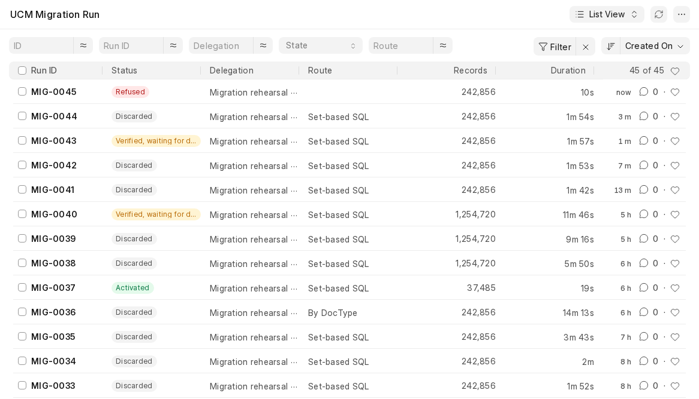
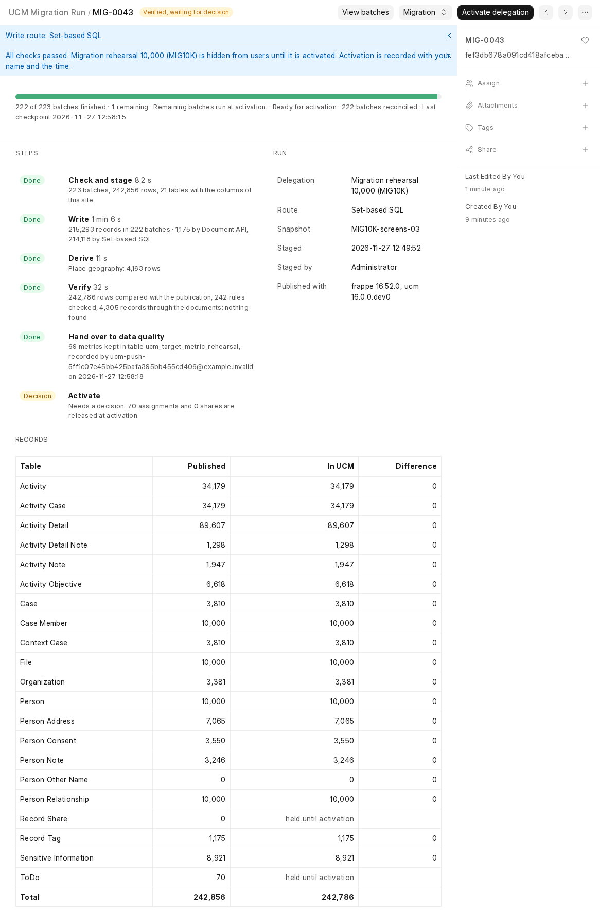
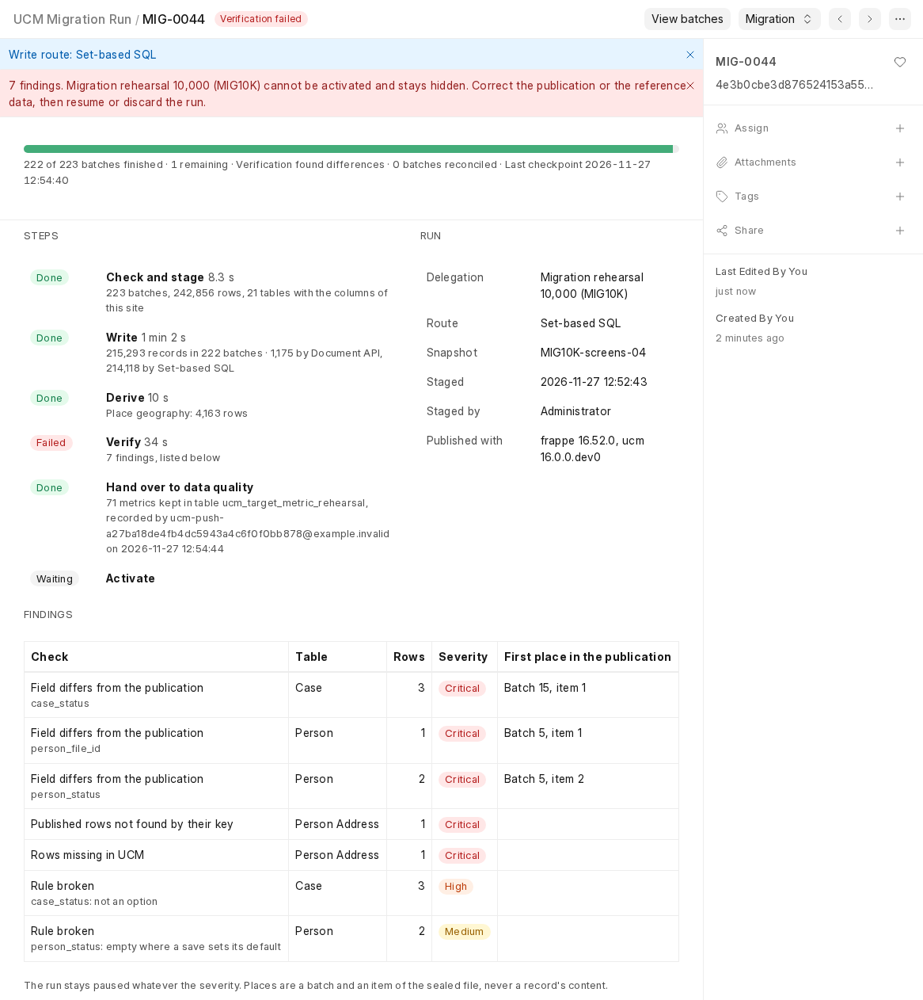
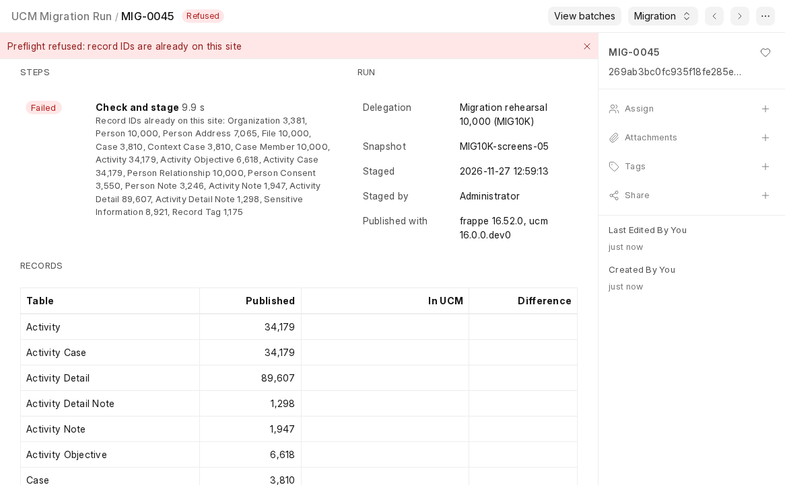
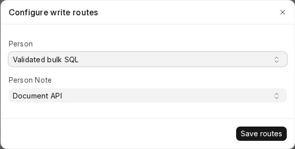
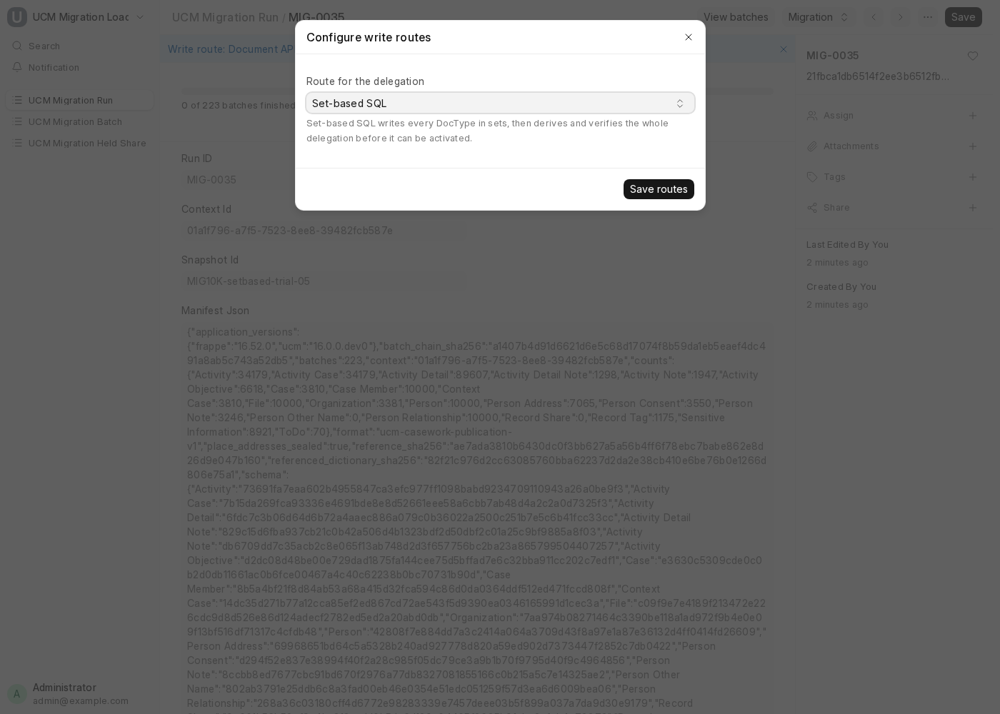
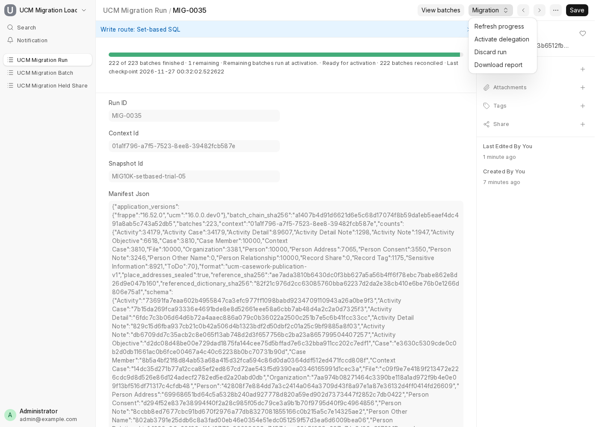

# UCM Migration Loader

Migrate one delegation from a published MariaDB snapshot into a shared UCM site. The publishing team runs **`ucm-push`**. The receiving team runs the **UCM Migration Loader** Frappe app, reviews the import in Desk and decides when to open the delegation.

| Where | Component | Access it needs |
|---|---|---|
| Publishing host | Python CLI | Read-only MariaDB access to the final UCM-shaped publication, read access to published private files, and an HTTPS publishing credential |
| Receiving site | Frappe app and migration worker | The site's existing database and private file storage. A **Migration Admin** approves hand-offs and controls apply, pause, discard and activation. A System Manager reads the runs and gives that role |
| Desk | UCM Migration Run, UCM Migration Batch, UCM Migration Held Share | Operators review progress, write routes, committed batches, reconciliation and historical shares |

**Operating a migration?** The [user manual](docs/user-manual.html) takes the publishing operator, the site operator and the migration team through a delegation step by step, with pictures of every screen. Open the file in a browser. This README is the technical reference.

[Install](#install) · [The short way](#the-short-way) · [Prepare and send a delegation](#prepare-and-send-a-delegation) · [Operate the run in Desk](#operate-the-run-in-desk) · [Set-based SQL route](#set-based-sql-route) · [All CLI commands](#all-cli-commands) · [Recovery](#recovery)

## Install

In the commands below, `https://github.com/ORGANISATION/REPOSITORY.git` stands for the address of your organisation's repository of the loader; you need read access to it. Whatever the repository is called, the app, and its folder in a bench, is `ucm_migration_loader`.

**Publishing host.** Use Python 3.11 or newer. The CLI works independently of Bench. The source database must already contain the mapped UCM tables with matching DDL.

```sh
git clone https://github.com/ORGANISATION/REPOSITORY.git ucm_migration_loader
cd ucm_migration_loader
python3 -m venv .venv
. .venv/bin/activate
python -m pip install .
ucm-push --help
```

To take a newer version later, from that folder:

```sh
git pull
. .venv/bin/activate
python -m pip install .
```

**Receiving host.** In a Frappe bench with UCM installed on the target site, install the app and sync its DocTypes. The full-publication cleanup implementation uses a Frappe 16.52.0 change. Review the [framework patch](dist/frappe-16.52.0-migration-cleanup.patch) and the [cleanup dependency](REHEARSALS.md#operating-and-cancelling-a-sealed-publication) before enabling discard on a new bench.

```sh
export TARGET_SITE=ucm.example.org
bench get-app ucm_migration_loader https://github.com/ORGANISATION/REPOSITORY.git
bench --site "$TARGET_SITE" install-app ucm_migration_loader
bench --site "$TARGET_SITE" migrate
```

To take a newer version later, pull it, migrate, and restart every process of the bench, the workers included: a worker keeps the code it started with.

```sh
git -C apps/ucm_migration_loader pull
bench --site "$TARGET_SITE" migrate
bench restart        # or restart the bench's processes as this environment runs them
```

Register the queue under the existing `workers` object in the bench's `sites/common_site_config.json`. Merge the following entry with any existing queues. Start the worker under the bench process manager used for this environment. For a foreground run:

```json
{"workers": {"ucm_migration": {"timeout": 300, "background_workers": 1}}}
```

```sh
bench worker --queue ucm_migration
```

## The short way

Both operators have a short form of their commands. It does what the detailed commands of the next section do, in fewer steps, and answers in sentences.

**Publishing operator.** `ucm-push init` writes the host's three files into the folder you name, private from the start, for you to fill in: the settings (`ucm-push.toml`) and the two database connections (`source.json`, `quality-db.json`). The [samples](samples/) folder shows the same files, with every key explained.

```sh
ucm-push init /srv/migration
```

The settings file holds what is the same for every delegation, and names the private files that hold the passwords and the token. It is read from the folder you work from, or from the file named with `--config` or `UCM_PUSH_CONFIG`.

```toml
site = "ucm.example.org"                                    # the receiving site, as its bench names it
url = "https://ucm.example.org"                             # its HTTPS address
source_config = "/srv/migration/credentials/source.json"    # read-only database connection (PyMySQL)
private_files = "/srv/publication/private/files"            # the pictures of the published persons
publications = "/srv/migration/publications"                # a folder per snapshot is made here
token_file = "/srv/migration/credentials/ucm-token"         # key:secret of the publishing account, mode 600
quality_config = "/etc/ucm-migration/quality-db.json"       # optional: the data quality database
```

```sh
ucm-push seal DEMO01                # by the delegation's code: inventory, sealed file and hand-off, in a new folder
ucm-push propose DEMO01-2026-11-27  # put the hand-off before the site's migration team, and get its check code
ucm-push send DEMO01-2026-11-27     # after their approval; run it again after an interruption
ucm-push status DEMO01-2026-11-27   # where the run stands on the site
ucm-push quality DEMO01-2026-11-27  # the run's metrics, to metrics.csv in the folder and to the database named
```

The two connection files are the arguments of one database connection each, as JSON. `source.json` is an account that only reads the publishing database; `quality-db.json` is an account that writes the metrics table. A server on the same host is named by `unix_socket` in place of `host` and `port`, and `ssl_ca` connects over TLS: see [samples/README.md](samples/README.md).

```json
{
	"host": "publisher-db.example.org",
	"port": 3306,
	"user": "migration_reader",
	"password": "<password of the read-only account>",
	"database": "ucm_publication"
}
```

`propose` sends the hand-off to the site, never the sealed file: the delegation, its row counts and the file's size and fingerprint. It shows in the Desk as a run that is **Proposed, to approve**, and the command answers with a check code, the first eight characters of the file's fingerprint:

```text
Proposed to the site as MIG-0070.
Give the site's migration team this check code yourself: AE06-4673
They type it to approve. When ucm-push status says Approved, send the file: ucm-push send
```

Tell the code to the person who approves, by a way that does not pass through the site: a call, a message. The site does not show it, so a proposal made with your token by someone else carries a code you never gave. The publishing account needs the **Migration Publisher** role to propose; without it, deliver `handoff.json` to the migration team instead.

`seal` names the snapshot after the code and the date, and never reuses a name. The later commands take the snapshot's name, or nothing when run from inside its folder: the run is read from the hand-off there. `ucm-push sent` shows how far a transfer got. `ucm-push --help-settings` describes the settings file.

**Site operator.** In the Desk, as a **Migration Admin**. The app brings two roles, which a System Manager gives: **Migration Admin** to the people who run migrations, and **Migration Publisher** to the publishing accounts that may propose their hand-offs. A System Manager without the Migration Admin role reads the runs and cannot act on them.

1. Open **UCM Migration Run**. A proposed hand-off is a run that is **Proposed, to approve**: open it. Its form says which account proposed it and when, and nothing is accepted for it yet.
2. Click **Approve hand-off**. The dialog shows the delegation, the snapshot, the rows, the file's size, the account that proposed, and whether the site has a context ready. Type the **Check code** the publishing operator told you, and click **Approve**. A code that does not match is refused. You cannot approve a proposal of your own account, nor one of a Migration Admin's. Where the site has no context for the delegation, the approval makes it, locked and hidden, under the published identifier, with the code and the name shown. **Migration → Decline** turns the proposal down.
3. The publication is now a run that is **Waiting for the file**, and shows how much has arrived. When the whole file is there, the migration worker stages it by itself, in the name of the person who approved: the run becomes **Staged**, or **Refused** with the reason. **Migration → Stage now** asks for the staging again after a failure; **Withdraw approval** takes the approval back.

A hand-off delivered as a file is approved from the same list: click **Approve a hand-off**, choose the `handoff.json`, check the fingerprint the dialog shows against the one you were given, choose the **Publishing account** that will send the file, and click **Approve**.

From the bench, the same two steps, for a site without a browser at hand and for scripts:

```sh
bench --site ucm.example.org ucm-migration approve /srv/approved/DEMO01/handoff.json --publisher publisher@example.org
bench --site ucm.example.org ucm-migration stage /srv/approved/DEMO01/handoff.json
```

**Sentences or JSON.** At a terminal the commands answer in sentences. Redirected or piped, they answer in JSON, as scripts expect; `--json` and `--text` choose outright. `tests/operator_flow.py` runs this whole way with the real commands over TLS; with `--desk` the hand-off is proposed with `ucm-push propose`, approved in a browser with its check code (`e2e/site_operator.py`), and staged by the worker.

## Prepare and send a delegation

The detailed commands take every value as an option, for scripts and for cases the short way does not cover. The following example uses Bash, `jq`, and a synthetic context UUID. Replace the example host, UUID, paths and accounts with the values for the delegation. Use a new private working directory for each snapshot.

### 1. Prepare the receiving context

Create an empty **Context** with the same UUID and code as the published delegation. Set **Context Status** to **Locked** and **Context Discoverability** to **Hidden**. For example, on the receiving bench:

```sh
bench --site "$TARGET_SITE" console
```

```python
context_id = "b9d729a1-eeb8-45f5-93b7-12ca51bc447b"
ctx = frappe.get_doc(
	{
		"doctype": "Context",
		"context_code": "DEMO01",
		"context_name": "Synthetic delegation",
		"context_status": "Locked",
		"context_discoverability": "Hidden",
	}
).insert(set_name=context_id)
assert ctx.name == context_id
frappe.db.commit()
```

Provision UCM's shared dictionaries, referenced catalogs, historical users, sensitive-field policy, context exemptions and intended access grants. UCM document sharing must be disabled in System Settings. For the first delegation these prerequisites may need initial setup. For later delegations, prepare the incoming context while existing contexts remain active.

### 2. Inspect and prepare the publication on the publishing host

`source.json` contains PyMySQL connection arguments for a read-only account ([sample](samples/source.json), [every key explained](samples/README.md)). Store the actual credential outside the repo in a private file. A local MariaDB publisher can use `unix_socket` in place of the host and port.

```json
{"host":"publisher.example.org","port":3306,"database":"ucm_publication","user":"migration_reader","password":"<read-only database password>"}
```

```bash
umask 077
export TARGET_SITE=ucm.example.org
export UCM_URL=https://ucm.example.org
export CONTEXT_ID=b9d729a1-eeb8-45f5-93b7-12ca51bc447b
export SNAPSHOT=DEMO01-publication-01
export PUBLISH_DB_CONFIG=/srv/migration/credentials/source.json
export PRIVATE_FILES=/srv/publication/private/files
mkdir -p "$HOME/ucm-publications/$SNAPSHOT"
cd "$HOME/ucm-publications/$SNAPSHOT"
export PUBLICATION="$PWD/delegation.sqlite"

src=(--site "$TARGET_SITE" --context "$CONTEXT_ID" --snapshot "$SNAPSHOT" --source-config "$PUBLISH_DB_CONFIG")
ucm-push source-inventory "${src[@]}" > inventory.json
ucm-push upload-order "${src[@]}" --batch-size 1000 > activity-order.json
ucm-push prepare "${src[@]}" --private-files "$PRIVATE_FILES" \
  --publication-out "$PUBLICATION" --findings-out "$PWD/findings.jsonl" \
  --batch-size 1000 --batch-bytes 4194304 > prepared.json
export RUN_ID="$(jq -er '.run' prepared.json)"
ucm-push check-publication --site "$TARGET_SITE" --publication "$PUBLICATION" \
  --run "$RUN_ID" > handoff.json
jq '{run,site,snapshot,batches,counts,file_bytes,file_sha256}' handoff.json
```

The default is 100 parent documents and 256 KiB per batch. Full publications allow up to 1,000 parent documents and 4 MiB per batch. The first limit reached closes the batch. Child rows belong to their parent. The planner orders activities by dependency. A 1,000-person batch can produce one multi-row Person SQL statement when the records fit and have no dependencies requiring an earlier flush. Private picture bytes are sealed with their metadata. Supply `--ucm-version` to `prepare` if the publishing database lacks installed UCM version metadata.

### 3. Approve, transfer and stage

Deliver the independently reviewed `handoff.json` to the receiving operator. On the receiving bench, bind its digest and byte count to an enabled publishing account:

```bash
bench --site "$TARGET_SITE" execute ucm_migration_loader.operator.approve_sealed \
  --kwargs '{"handoff_path":"/srv/approved/DEMO01/handoff.json","publishing_user":"publisher@example.org"}'
```

On the publishing host, load the publisher's Frappe API key and secret from your credential store as `UCM_MIGRATION_TOKEN` in `key:secret` format. For a private TLS authority, set `REQUESTS_CA_BUNDLE` to its CA bundle.

```bash
remote=(--site "$TARGET_SITE" --url "$UCM_URL" --run "$RUN_ID")
ucm-push transfer-status "${remote[@]}"
ucm-push send-publication "${remote[@]}" --publication "$PUBLICATION" --progress
```

This transfers one sealed file in resumable 512 KiB chunks. On the receiving bench, set `RUN_ID` from the approved handoff and stage the uploaded file:

```bash
export RUN_ID="$(jq -er '.run' /srv/approved/DEMO01/handoff.json)"
bench --site "$TARGET_SITE" execute ucm_migration_loader.publication_transport.receive \
  --kwargs "$(jq -nc --arg run "$RUN_ID" '{run:$run}')"
```

At **Publication staged**, the receiver has verified the file and recorded the planned batch count. Applied batches should be zero. Desk shows a short ID such as `MIG-0028`. CLI commands use the full digest in `RUN_ID`.

## Operate the run in Desk

1. Search Desk for **UCM Migration Run** and open the staged run. Choose **Migration → Configure write routes**. Either set **Route for the delegation** to **Set-based SQL**, which loads the whole delegation in sets (see [Set-based SQL route](#set-based-sql-route)), or leave it at **Chosen per DocType** and select, for example, **Validated bulk SQL** for Person and **Document API** for Person Note. Click **Save routes**. All published parent DocTypes support either per-DocType route. The saved plan locks once apply starts, and the form shows it as **Write route**.
2. Choose **Migration → Apply hidden batches**. **Refresh progress** shows committed and remaining batches. **View batches** opens receipts for this run. Open an individual receipt to see its sequence, published DocType, actual write route and digest.
3. At **Publication ready**, read the overview on the form, and choose **Download report** for the full record. The worker compares counts, stored fields, child order, historical audit fields, attachments and references against the publication. Deferred assignments and shares are counted separately. A failed check blocks activation.
4. After review, choose **Activate delegation**. Activation rechecks the import, releases eligible assignments and shares, and opens the context. **UCM Migration Held Share** records historical shares whose receiving delegation is inactive. UCM rechecks consent and eligibility when that delegation goes live. The worker opens the delegation after the request; the form follows it and shows the open delegation without a refresh.

### What the list and the form show

The **UCM Migration Run** list has one row per run: its short ID, a state, the delegation, the route, the records published and the time the load worked. The state reads as the migration team needs it: **Staged**, **Loading, 62 %**, **Paused**, **Verification failed**, **Verified, waiting for decision**, **Activated**, **Discarding**, **Discarded** or **Refused**. Filter by delegation, state or route.



A run's form opens on an overview, read from what the run keeps and refreshed every ten seconds while a load or a discard is at work:

- **Steps**: check and stage, write, derive (set-based route), verify, hand over to data quality, activate, and discard where there was one. Each has a status, the time it took, and one line of figures.
- **Run**: delegation, route, snapshot, who staged it and when, the application versions the publication was made with.
- **Records**: the rows of each table in the publication and in UCM, and their difference. Assignments and shares are held until activation; afterwards the table shows how many were released and how many shares are kept for delegations that are not live yet.
- **Findings**, when a verification found something: the check, the table, the rows, a severity and the first place in the publication (batch and item). No record ID and no field value is shown. Resolve a place on the publishing host with `ucm-push locate-item`.

A load or a discard whose job is gone says so in red above the overview, with the batch it had reached: the form looks the run up in the migration queue once its worker has been quiet for a minute. The list keeps showing **Loading**; open the run to see it.

A run that waits for the go-live decision says so above the overview and offers **Activate delegation** as its main button. The form has no **Save**: a run changes through its actions only.



A run whose verification found something stays paused and hidden, whatever the severity of the findings:



A sealed file the site refuses at staging is kept as a **Refused** run, so that the refusal is not only a line in a terminal. It shows what differs: the tables whose columns differ from this site, the application versions, or the record IDs that are already there. A refused run holds no file and no rows. Staging the same file again, after the cause is corrected, checks it from the start and continues in the same run.



## Hand the metrics to the data quality database

The UCM site connects to nothing on the migration side. The publishing host asks the site for a run's metrics and stores them where the migration team keeps its own, so that the source, the migration database and the target can be reconciled in one place.

```bash
ucm-push quality "${remote[@]}" --quality-config /etc/ucm-migration/quality-db.json
ucm-push quality "${remote[@]}" --quality-out "$RUN_ID-metrics.csv"
```

- `--quality-config` is a private PyMySQL connection JSON, as `--source-config` ([sample](samples/quality-db.json)). The rows go into the table `ucm_target_metric` (`--quality-table` names another; `--create-quality-table` creates it when it is absent). A run's rows replace the rows the same run left before, in one transaction, so the command can be repeated after every step.
- `--quality-out` writes the same rows to a file: CSV for a `.csv` name, JSON otherwise. Both options can be given together.
- The site then records on the run that the metrics were stored, by which account and where (the table's or the file's name, nothing else). The form shows it as the step **Hand over to data quality**. The record is refused when the run has changed since the metrics were read. A hand-over counts for the metrics the run holds at that moment: after a later step, such as the activation that releases the assignments and shares, the form shows the step as due again until the command is repeated.
- The account that sent a run's sealed file may read the status, the report and the metrics of that run, and of no other. A Migration Admin's token works for every run.
- Set `ucm_migration_quality_url` in the site config to a link containing `{run}` (and `{context}` where the dashboard needs it), and the form offers **Open in data quality dashboard**. A running site reads the setting within a minute.

Each row carries the run, site, context, context code, snapshot, route, state and the time of the run's last change, then:

| Category | Metric | Per | Passes when |
|---|---|---|---|
| Completeness | Number of records, Lost records | table | the target holds every published row |
| Completeness | Access rows held for activation | assignments, shares | informative until activation; afterwards released plus held equals published |
| Field-level accuracy | Exact match per field | table | no stored column differs from the publication |
| Field-level accuracy | Hash exact match | run | the batch receipts chain to the publication's digest |
| Referential integrity | Integrity rule broken | table and rule | listed only when broken |
| Referential integrity | Integrity rules broken, Sampling validation | run | no rule is broken; every sampled record passed the document check |
| Cross-cutting | Errors count by severity | severity | zero |
| Cross-cutting | Migration time, seconds | step | informative |

Severities follow the scale of the migration's quality metrics. A missing row, a field that differs, a link to nothing or out of the delegation is **CRITICAL**; a value outside its list, a missing required value or any other broken rule is **HIGH**; a default left empty is **MEDIUM**. This mapping is the loader's reading of that scale and is one table in `data_quality.py`. The loader itself does not weigh severities: any finding keeps the run paused.

```sql
create table if not exists `ucm_target_metric` (
	run char(64) not null, site varchar(140) not null, context varchar(140) not null, context_code varchar(140),
	snapshot varchar(140) not null, route varchar(60), state varchar(60), generated_on datetime(6) not null,
	category varchar(60) not null, metric varchar(80) not null,
	entity varchar(140) not null default '', rule varchar(190) not null default '',
	source_value decimal(30, 6), target_value decimal(30, 6), value decimal(30, 6),
	target varchar(60), severity varchar(20), passed tinyint,
	primary key (run, category, metric, entity, rule)
)
```

## More screens

**Write routes on a staged run**



**A reconciled run with two committed batches**


**View batches filtered to one run**


## All CLI commands

These examples reuse the Bash arrays and variables from steps 2 and 3. For operator actions, run in a separate shell with the same target variables and a **Migration Admin's** token. Commands such as `apply` enqueue work. Poll `status` for the resulting state.

| Command | What it does | Example |
|---|---|---|
| `init` | Short way: write the settings file and the two connection files, to fill in | `ucm-push init /srv/migration` |
| `seal` | Short way: inventory, sealed file and hand-off for one delegation, by its code | `ucm-push seal DEMO01` |
| `propose` | Short way: put a sealed publication's hand-off before the site's migration team, and print its check code | `ucm-push propose DEMO01-2026-11-27` |
| `send`, `sent` | Short names of `send-publication` and `transfer-status` | `ucm-push send DEMO01-2026-11-27` |
| `source-inventory` | Count source rows and identify unsupported business rows | `ucm-push source-inventory "${src[@]}"` |
| `upload-order` | Preview activity dependency order and batch planning | `ucm-push upload-order "${src[@]}" --batch-size 1000` |
| `prepare` | Write a sealed delegation publication to a new file | `ucm-push prepare "${src[@]}" --private-files "$PRIVATE_FILES" --publication-out "$PUBLICATION" --batch-size 1000 --batch-bytes 4194304` |
| `check-publication` | Verify the sealed file, site, manifest and digest, and emit the handoff | `ucm-push check-publication --site "$TARGET_SITE" --publication "$PUBLICATION" --run "$RUN_ID"` |
| `send-publication` | Upload the approved file, resuming from the acknowledged offset | `ucm-push send-publication "${remote[@]}" --publication "$PUBLICATION" --progress` |
| `transfer-status` | Read expected byte count and acknowledged offset | `ucm-push transfer-status "${remote[@]}"` |
| `apply` | Start or resume applying committed business batches. Optionally stop after a bounded number of new batches | `ucm-push apply "${remote[@]}" --max-batches 1` |
| `status` | Show run state, received and applied counts, and the first finding | `ucm-push status "${remote[@]}"` |
| `pause` | Stop the worker at a batch boundary | `ucm-push pause "${remote[@]}"` |
| `report` | Read reconciliation, held-share outcomes and activation details | `ucm-push report "${remote[@]}" > report.json` |
| `quality` | Store the run's data quality metrics in a table or a file on the publishing side, and record the hand-over on the run | `ucm-push quality "${remote[@]}" --quality-config quality-db.json` |
| `locate-item` | On the publishing host, resolve a finding's one-based batch and item to its source record | `ucm-push locate-item --site "$TARGET_SITE" --publication "$PUBLICATION" --run "$RUN_ID" --sequence 2 --item 1` |
| `activate` | Request activation of a reviewed ready delegation | `ucm-push activate "${remote[@]}"` |
| `discard` | Cancel a hidden run and remove its imported rows while retaining receipts | `ucm-push discard "${remote[@]}"` |

### Bounded case-file pilot commands

The pilot supports a smaller case-file profile and has its own manifest, approval and verification steps. It also supports `status`, `apply`, `pause`, `report`, `activate` and `discard`. Select the same `--profile`, `--attempt`, snapshot and batch limits for both plan and push. The pilot requires the target context description `Synthetic UCM migration rehearsal`.

| Command | What it does | Example |
|---|---|---|
| `assess` | Check whether the source fits the selected pilot profile | `ucm-push assess "${src[@]}"` |
| `plan` | Generate the pilot manifest for target approval | `ucm-push plan "${src[@]}" --manifest-out manifest.json` |
| `push` | Send pilot document batches after approval | `ucm-push push "${src[@]}" --url "$UCM_URL" --max-batches 1` |
| `verify` | Request verification of a staged pilot | `ucm-push verify "${remote[@]}"` |
| `reconcile` | Compare an independently reviewed pilot projection to the target report | `ucm-push reconcile "${remote[@]}" --expected expected.json` |

For the pilot, use the run digest from `plan` in `remote`. The receiving operator approves the reviewed manifest with `ucm_migration_loader.operator.prepare_publication`. See the [pilot approval example](REHEARSALS.md#push-a-publication) and [expected JSON format](REHEARSALS.md#compare-an-independent-expected-result). The CLI accepts the legacy spellings `activity-order` for `upload-order` and `freeze` for `prepare`. Run `ucm-push --help` for every flag.

## Recovery

| Situation | Operator action |
|---|---|
| Upload interrupted | Check `transfer-status` and repeat `send-publication` using the same approved file and digest. |
| Apply interrupted | Check `status` or the run's **Finding**. Each successful business batch and its receipt commit together. Resume with `apply` after correcting the reported issue. |
| Source data needs correction | Review and discard the hidden run, correct the source, then prepare a new full publication with a new snapshot identity. For the bounded pilot, increment `--attempt`. |
| Write-route menu missing | Open a full **Publication staged** run before its first apply request. |
| Staging refused | Open the **Refused** run the staging left: its first step says what differs. Correct the site (release, reference data) or prepare a new publication, then stage again. |
| The form says **No job is working on this load** (or discard) | The job's process was killed or its worker went down. The run kept its state and nothing is half written: every batch with a receipt is stored whole, and the rows of the batch that was being written are gone. Choose **Migration → Resume from last receipt** (or **Resume cleanup**): the load goes on after the last receipt, and the verification after the last batch it had compared. |
| Paused with `apply after committed batch N: OperationalError` | The job lost its database connection, and took a new one to record it. Check the database, then **Resume from last receipt**. |
| Set-based run paused with **Verification found** | Open the run: **Findings** lists each check with its severity, and each field that differs with the batch and item of its first occurrence; resolve it with `locate-item`. The downloaded report holds the same under `findings`. Correct the cause and resume: the delegation is derived and verified again from the first batch. If the publication itself is wrong, discard the run. |
| Ready but some batches remain | Inspect the report's deferred access counts. Eligible assignments and shares are handled during activation. |

[Developer rehearsals, reference-data checks, test commands and benchmark procedures](REHEARSALS.md)

## Set-based SQL route

The document routes save every published record through its controller, about a hundred records a second. The set-based route copies the published rows into UCM's tables with multi-row inserts and applies the rules afterwards, over the whole delegation. On a 10,000-person delegation of 243,000 rows it reached **Publication ready** in three to four minutes where the document route took 49, with the same stored rows ([measurements](REHEARSALS.md#set-based-sql-route)).

Choose it per run in **Configure write routes**, or from the receiving bench:

```sh
bench --site "$TARGET_SITE" execute ucm_migration_loader.write_routes.select \
  --kwargs "$(jq -nc --arg run "$RUN_ID" '{run:$run, route:"Set-based SQL"}')"
```



To make it the route every newly staged run starts with, set it on the site. An operator can still change a staged run before its first apply.

```sh
bench --site "$TARGET_SITE" set-config ucm_migration_route "Set-based SQL"
```

Everything else is operated as before: **Apply hidden batches**, **Pause after current batch**, **Resume from last receipt**, **Activate delegation** and **Discard run** in Desk, or `apply`, `pause`, `status`, `report`, `activate` and `discard` with `ucm-push`. The run passes through these phases, shown beside the batch progress:

| Phase | What the worker does | Where it resumes |
|---|---|---|
| Writing *DocType* | Inserts the rows of up to 5,000 parent records per transaction, with their child rows, private pictures and batch receipts. Sensitivity tags are saved through their documents | After the last committed batch |
| Deriving | Sets the values a save would derive, for this delegation only: an activity's place type, country and areas from its Place, the department and country copies on history rows and notes, the share facts and the latest-state marks | Runs again; rows that already hold the value are not written |
| Verifying | Compares every stored column with the publication, batch by batch, and passes one record in fifty through the document route's own check | After the last compared batch |
| Ready for activation | Counts the delegation, counts the rows that break a rule a query can check (required fields, options, links, option sets and collections, links that leave the context, places, a relationship recorded twice, history locks), and compares the receipts with the publication. With no finding the run becomes **Publication ready** and the report can be downloaded | — |



A job works for about two minutes on the batches and then hands over to the next job. A pause takes effect at the next transaction while writing and within about ten seconds while verifying, and a restarted worker loses at most one transaction. The live-load thresholds below pause this route as well. A failed step pauses the run with its finding; **Resume from last receipt** continues from the phase and batch it had reached.

Activation releases the held assignments and shares through their documents and opens the context in one transaction. It reads the row counts and receipts again; it does not read every record again, because the context has been locked and hidden since the verification. **Discard run** removes the delegation's rows by primary key, 5,000 at a time, and does not need the Frappe change the document routes' cleanup depends on.

To have more records checked through the documents, lower the sampling interval on the site; `1` checks every record, at the document route's speed for that phase.

```sh
bench --site "$TARGET_SITE" set-config ucm_migration_sample_every 10 --parse
```

Know these limits before choosing the route:

- No controller runs for a copied row. A controller rule that is not in the verification's list is checked on the sampled records only.
- The verification's list is a reading of UCM's rules as they were when the route was reviewed. The app's tests read the code a save runs in UCM for every table the route writes, and fail when it differs from the reviewed one (`ucm_rules.py`, `ucm_rules_reviewed.json`); see [Tests](#tests). A UCM that has changed since is reviewed before the route is used with it.
- The route runs on a UCM with or without the home's record counts (`ucm.permissions.counts`): where UCM keeps them, they move with the rows written or removed.
- A private picture keeps its published file name. The document routes may store the same bytes under another name.
- Assignments and shares are released in one transaction at activation, as on the document routes. A delegation with 11,000 shares had an activation of about three minutes.
- A share that UCM's current rules no longer allow stops the verification, with its batch and item in the finding. Correct the consent or the publication and resume.
- The largest delegation loaded by this route had 1.25 million rows and reached **Publication ready** in 10.5 minutes on a quiet development site, and in 13 minutes while eight simulated caseworkers worked in other delegations without a failed request or a lock wait. A discard disturbed them more than a load did: schedule it, like a load, outside the busiest hours. Rehearse a delegation of the expected size on a production-like environment before relying on the figures.

## Tests

Three kinds, each run where it fits. Synthetic data only.

| Kind | Where | Run with | Needs |
|---|---|---|---|
| Unit tests | `tests/test_*.py` | `pytest` from the app folder | Frappe importable; no site, no database, no ucm |
| Integration tests | `ucm_migration_loader/tests/` and beside the DocType | `bench --site SITE run-tests --app ucm_migration_loader` | a site with ucm and the loader installed |
| Rehearsals and browser tests | the other files of `tests/`, and `e2e/` | by hand, from the bench; see [REHEARSALS.md](REHEARSALS.md) | a development site that is being served, with a worker and generator data |

- The unit tests cover what needs no site: the pilot contract, the sealed file's index, the set-based route's planning, the run's overview and metrics, `ucm-push quality` with the site's answers played back, and the short commands with their settings file.
- The integration tests cover what the site decides: who may approve and act (the Migration Admin role), who may propose (the Migration Publisher role), the proposal with its check code, the approval of a hand-off with its context, the run that waits for its file and its staging on arrival, who may read a run and its metrics, the hand-over record, a sealed file that is refused for each reason and staged again afterwards, the account a transfer names, the list's columns, and what the form shows in every state. They build their own runs and a small sealed file by hand, roll everything back and remove the files they stage, so they can run on a site that holds loaded delegations. They do not load a delegation: a load commits, and is rehearsed instead.
- The rehearsals load, verify, hand over, activate and discard real generator delegations through the bench's own worker, and the browser tests drive the Desk form through the same steps.
- `e2e/manual_screenshots.py` takes the pictures of the user manual from runs in the situations it describes, into `docs/images/user-guide/`; `e2e/site_operator.py --shots` takes those of the approval. The manual embeds them.
- `tests/set_based_kill.py` ends the job of a set-based load at seven points (inside a write transaction, between two, during the derive, the verification, the conclusion, the activation and the discard), by killing its process or cutting its database connection, and checks what is left and that the resumed load is the same as an undisturbed one.

**When UCM changes a rule.** The set-based route states UCM's save rules again as queries, so a rule UCM adds or changes has to be followed. Two integration tests watch for it (`ucm_migration_loader/tests/test_rules_against_ucm.py`), and the CI runs them every night against UCM's develop branch:

- *The code a save runs.* For each table the route writes, the hooks of UCM's controller and the UCM functions they call are fingerprinted (comments and layout aside) and compared with `ucm_rules_reviewed.json`. A difference fails the test and names what is new, gone or changed. Read the change, add or adjust the rule in `set_based` where the route copies it, then keep the new reading:

  ```sh
  bench --site DEVELOPER_SITE execute ucm_migration_loader.ucm_migration_loader.ucm_rules.review
  ```

- *The same records, read both ways.* Records saved through UCM's documents must break none of the route's rules; a record UCM's document refuses (a value outside its options or its list, a required field left empty, a link to another context's record, a place its activity type does not allow, a relationship recorded twice) must be found by the rule that names it; and the place type and address a save gives an activity must be what the route's derive step gives it.

The fingerprint follows a hook and the functions it calls directly, not what those call in turn.

`.github/workflows/ci.yml` runs the unit tests and, on MariaDB 11.8 and Frappe version-16, the integration tests. The integration tests need ucm, whose repository is private: set the repository secret `UCM_CLONE_URL` to a clone URL that can read it, or that job is skipped with a warning. `.github/workflows/linters.yml` runs the commit-title check, pre-commit (ruff, prettier, eslint), Frappe's Semgrep rules and pip-audit on every pull request. Run `pre-commit run --all-files` before committing.

## Operating larger publications

After updating an existing receiver, run `bench --site TARGET migrate` and restart the web processes and workers. Open the migration run in Desk to see the last worker checkpoint, phase and reconciled batch count. Open a business batch receipt for its parent row count, publication and attachment bytes, write time, measured validation time, attachment time and reconciliation time. Validation and attachment work can take place inside the write phase, so these durations overlap.

Staging verifies the entire SQLite file and builds a private index of its approved batch hashes. Workers check the sealed file identity and the next batch hash. If a site restore changes the file identity, an operator can rebuild the index after verifying the restored file against the original manifest:

```sh
bench --site TARGET execute ucm_migration_loader.publication_receiver.rebuild_index --kwargs '{"run":"RUN_DIGEST"}'
```

Reconciliation saves progress after at most 25 business batches, or at a batch boundary after ten seconds. Resume a paused apply from Desk after reviewing its finding. Activation checks the inventory and access policy again. For simple Person and Person Note batches with a prior successful check, the worker locks the current records and compares their fingerprint. Changed batches and batches with complex relationships or files receive the full check.

Operators can set thresholds per receiving site. The following example pauses apply when observed live read or write p95 exceeds 500 ms, or when more than two database row lock waits are active. Set values from the site's measured traffic and agreed service targets.

```sh
bench --site TARGET set-config ucm_migration_live_p95_ms 500 --parse
bench --site TARGET set-config ucm_migration_max_lock_waits 2 --parse
```

The latency check uses up to 256 recent samples per read/write category from resource, v2 document and Desk form endpoints in the previous minute. The lock counter covers the whole MariaDB server. Both checks are optional. The worker evaluates them between business batches and reconciliation slices. A paused run requires an operator to resume it. Activation is a single transaction and should be timed separately when qualifying a live delegation.
