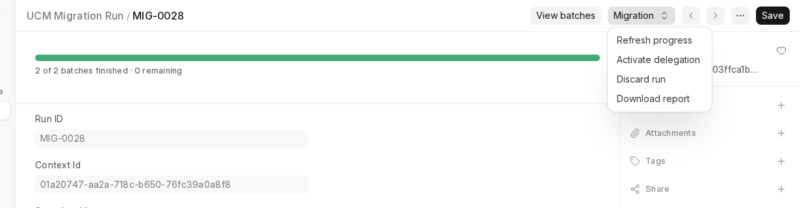
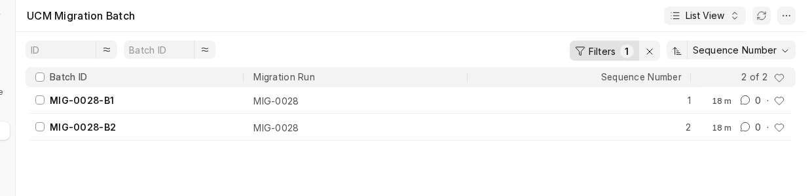

# UCM Migration Loader

Migrate one delegation from a published MariaDB snapshot into a shared UCM site. The publishing team runs **`ucm-push`**. The receiving team runs the **UCM Migration Loader** Frappe app, reviews the import in Desk and decides when to open the delegation.

| Where | Component | Access it needs |
|---|---|---|
| Publishing host | Python CLI | Read-only MariaDB access to the final UCM-shaped publication, read access to published private files, and an HTTPS publishing credential |
| Receiving site | Frappe app and migration worker | The site's existing database and private file storage. A System Manager approves transfers and controls apply, pause, discard and activation |
| Desk | UCM Migration Run, UCM Migration Batch, UCM Migration Held Share | Operators review progress, write routes, committed batches, reconciliation and historical shares |

[Install](#install) · [Prepare and send a delegation](#prepare-and-send-a-delegation) · [Operate the run in Desk](#operate-the-run-in-desk) · [Set-based SQL route](#set-based-sql-route) · [All CLI commands](#all-cli-commands) · [Recovery](#recovery)

## Install

**Publishing host.** Use Python 3.11 or newer. Install from an authorized checkout of this repository. The CLI works independently of Bench. The source database must already contain the mapped UCM tables with matching DDL.

```sh
git clone https://github.com/QuarkCyberSystems/ucm_migration_loader.git
cd ucm_migration_loader
python3 -m venv .venv
. .venv/bin/activate
python -m pip install .
ucm-push --help
```

**Receiving host.** In a Frappe bench with UCM installed on the target site, install the app and sync its DocTypes. The full-publication cleanup implementation uses a Frappe 16.52.0 change. Review the [framework patch](dist/frappe-16.52.0-migration-cleanup.patch) and the [cleanup dependency](REHEARSALS.md#operating-and-cancelling-a-sealed-publication) before enabling discard on a new bench.

```sh
export TARGET_SITE=ucm.example.org
bench get-app https://github.com/QuarkCyberSystems/ucm_migration_loader.git
bench --site "$TARGET_SITE" install-app ucm_migration_loader
bench --site "$TARGET_SITE" migrate
```

Register the queue under the existing `workers` object in the bench's `sites/common_site_config.json`. Merge the following entry with any existing queues. Start the worker under the bench process manager used for this environment. For a foreground run:

```json
{"workers": {"ucm_migration": {"timeout": 300, "background_workers": 1}}}
```

```sh
bench worker --queue ucm_migration
```

## Prepare and send a delegation

The following example uses Bash, `jq`, and a synthetic context UUID. Replace the example host, UUID, paths and accounts with the values for the delegation. Use a new private working directory for each snapshot.

### 1. Prepare the receiving context

Create an empty **Context** with the same UUID and code as the published delegation. Set **Context Status** to **Locked** and **Context Discoverability** to **Hidden**. For example, on the receiving bench:

```sh
bench --site "$TARGET_SITE" console
```

```python
context_id = "b9d729a1-eeb8-45f5-93b7-12ca51bc447b"
ctx = frappe.get_doc({
    "doctype": "Context",
    "context_code": "DEMO01",
    "context_name": "Synthetic delegation",
    "context_status": "Locked",
    "context_discoverability": "Hidden",
}).insert(set_name=context_id)
assert ctx.name == context_id
frappe.db.commit()
```

Provision UCM's shared dictionaries, referenced catalogs, historical users, sensitive-field policy, context exemptions and intended access grants. UCM document sharing must be disabled in System Settings. For the first delegation these prerequisites may need initial setup. For later delegations, prepare the incoming context while existing contexts remain active.

### 2. Inspect and prepare the publication on the publishing host

`source.json` contains PyMySQL connection arguments for a read-only account. Store the actual credential outside the repo in a private file. A local MariaDB publisher can use `unix_socket` in place of the host and port.

```json
{"host":"publisher.example.org","port":3306,"database":"ucm_publication","user":"migration_reader","password":"<read-only database password>"}
```

```bash
umask 077
export TARGET_SITE=ucm.example.org
export UCM_URL=https://ucm.example.org
export CONTEXT_ID=b9d729a1-eeb8-45f5-93b7-12ca51bc447b
export SNAPSHOT=DEMO01-publication-01
export PUBLISH_DB_CONFIG=/srv/migration/credentials/source.json
export PRIVATE_FILES=/srv/publication/private/files
mkdir -p "$HOME/ucm-publications/$SNAPSHOT"
cd "$HOME/ucm-publications/$SNAPSHOT"
export PUBLICATION="$PWD/delegation.sqlite"

src=(--site "$TARGET_SITE" --context "$CONTEXT_ID" --snapshot "$SNAPSHOT" --source-config "$PUBLISH_DB_CONFIG")
ucm-push source-inventory "${src[@]}" > inventory.json
ucm-push upload-order "${src[@]}" --batch-size 1000 > activity-order.json
ucm-push prepare "${src[@]}" --private-files "$PRIVATE_FILES" \
  --publication-out "$PUBLICATION" --findings-out "$PWD/findings.jsonl" \
  --batch-size 1000 --batch-bytes 4194304 > prepared.json
export RUN_ID="$(jq -er '.run' prepared.json)"
ucm-push check-publication --site "$TARGET_SITE" --publication "$PUBLICATION" \
  --run "$RUN_ID" > handoff.json
jq '{run,site,snapshot,batches,counts,file_bytes,file_sha256}' handoff.json
```

The default is 100 parent documents and 256 KiB per batch. Full publications allow up to 1,000 parent documents and 4 MiB per batch. The first limit reached closes the batch. Child rows belong to their parent. The planner orders activities by dependency. A 1,000-person batch can produce one multi-row Person SQL statement when the records fit and have no dependencies requiring an earlier flush. Private picture bytes are sealed with their metadata. Supply `--ucm-version` to `prepare` if the publishing database lacks installed UCM version metadata.

### 3. Approve, transfer and stage

Deliver the independently reviewed `handoff.json` to the receiving operator. On the receiving bench, bind its digest and byte count to an enabled publishing account:

```bash
bench --site "$TARGET_SITE" execute ucm_migration_loader.operator.approve_sealed \
  --kwargs '{"handoff_path":"/srv/approved/DEMO01/handoff.json","publishing_user":"publisher@example.org"}'
```

On the publishing host, load the publisher's Frappe API key and secret from your credential store as `UCM_MIGRATION_TOKEN` in `key:secret` format. For a private TLS authority, set `REQUESTS_CA_BUNDLE` to its CA bundle.

```bash
remote=(--site "$TARGET_SITE" --url "$UCM_URL" --run "$RUN_ID")
ucm-push transfer-status "${remote[@]}"
ucm-push send-publication "${remote[@]}" --publication "$PUBLICATION" --progress
```

This transfers one sealed file in resumable 512 KiB chunks. On the receiving bench, set `RUN_ID` from the approved handoff and stage the uploaded file:

```bash
export RUN_ID="$(jq -er '.run' /srv/approved/DEMO01/handoff.json)"
bench --site "$TARGET_SITE" execute ucm_migration_loader.publication_transport.receive \
  --kwargs "$(jq -nc --arg run "$RUN_ID" '{run:$run}')"
```

At **Publication staged**, the receiver has verified the file and recorded the planned batch count. Applied batches should be zero. Desk shows a short ID such as `MIG-0028`. CLI commands use the full digest in `RUN_ID`.

## Operate the run in Desk

1. Search Desk for **UCM Migration Run** and open the staged run. Choose **Migration → Configure write routes**. Either set **Route for the delegation** to **Set-based SQL**, which loads the whole delegation in sets (see [Set-based SQL route](#set-based-sql-route)), or leave it at **Chosen per DocType** and select, for example, **Validated bulk SQL** for Person and **Document API** for Person Note. Click **Save routes**. All published parent DocTypes support either per-DocType route. The saved plan locks once apply starts, and the form shows it as **Write route**.
2. Choose **Migration → Apply hidden batches**. **Refresh progress** shows committed and remaining batches. **View batches** opens receipts for this run. Open an individual receipt to see its sequence, published DocType, actual write route and digest.
3. At **Publication ready**, choose **Download report**. The worker compares counts, stored fields, child order, historical audit fields, attachments and references against the publication. Deferred assignments and shares are counted separately. A failed check blocks activation.
4. After review, choose **Activate delegation**. Activation rechecks the import, releases eligible assignments and shares, and opens the context. **UCM Migration Held Share** records historical shares whose receiving delegation is inactive. UCM rechecks consent and eligibility when that delegation goes live.

**Write routes on a staged run**


**A reconciled run with two committed batches**



**View batches filtered to one run**



## All CLI commands

These examples reuse the Bash arrays and variables from steps 2 and 3. For operator actions, run in a separate shell with the same target variables and a **System Manager's** token. Commands such as `apply` enqueue work. Poll `status` for the resulting state.

| Command | What it does | Example |
|---|---|---|
| `source-inventory` | Count source rows and identify unsupported business rows | `ucm-push source-inventory "${src[@]}"` |
| `upload-order` | Preview activity dependency order and batch planning | `ucm-push upload-order "${src[@]}" --batch-size 1000` |
| `prepare` | Write a sealed delegation publication to a new file | `ucm-push prepare "${src[@]}" --private-files "$PRIVATE_FILES" --publication-out "$PUBLICATION" --batch-size 1000 --batch-bytes 4194304` |
| `check-publication` | Verify the sealed file, site, manifest and digest, and emit the handoff | `ucm-push check-publication --site "$TARGET_SITE" --publication "$PUBLICATION" --run "$RUN_ID"` |
| `send-publication` | Upload the approved file, resuming from the acknowledged offset | `ucm-push send-publication "${remote[@]}" --publication "$PUBLICATION" --progress` |
| `transfer-status` | Read expected byte count and acknowledged offset | `ucm-push transfer-status "${remote[@]}"` |
| `apply` | Start or resume applying committed business batches. Optionally stop after a bounded number of new batches | `ucm-push apply "${remote[@]}" --max-batches 1` |
| `status` | Show run state, received and applied counts, and the first finding | `ucm-push status "${remote[@]}"` |
| `pause` | Stop the worker at a batch boundary | `ucm-push pause "${remote[@]}"` |
| `report` | Read reconciliation, held-share outcomes and activation details | `ucm-push report "${remote[@]}" > report.json` |
| `locate-item` | On the publishing host, resolve a finding's one-based batch and item to its source record | `ucm-push locate-item --site "$TARGET_SITE" --publication "$PUBLICATION" --run "$RUN_ID" --sequence 2 --item 1` |
| `activate` | Request activation of a reviewed ready delegation | `ucm-push activate "${remote[@]}"` |
| `discard` | Cancel a hidden run and remove its imported rows while retaining receipts | `ucm-push discard "${remote[@]}"` |

### Bounded case-file pilot commands

The pilot supports a smaller case-file profile and has its own manifest, approval and verification steps. It also supports `status`, `apply`, `pause`, `report`, `activate` and `discard`. Select the same `--profile`, `--attempt`, snapshot and batch limits for both plan and push. The pilot requires the target context description `Synthetic UCM migration rehearsal`.

| Command | What it does | Example |
|---|---|---|
| `assess` | Check whether the source fits the selected pilot profile | `ucm-push assess "${src[@]}"` |
| `plan` | Generate the pilot manifest for target approval | `ucm-push plan "${src[@]}" --manifest-out manifest.json` |
| `push` | Send pilot document batches after approval | `ucm-push push "${src[@]}" --url "$UCM_URL" --max-batches 1` |
| `verify` | Request verification of a staged pilot | `ucm-push verify "${remote[@]}"` |
| `reconcile` | Compare an independently reviewed pilot projection to the target report | `ucm-push reconcile "${remote[@]}" --expected expected.json` |

For the pilot, use the run digest from `plan` in `remote`. The receiving operator approves the reviewed manifest with `ucm_migration_loader.operator.prepare_publication`. See the [pilot approval example](REHEARSALS.md#push-a-publication) and [expected JSON format](REHEARSALS.md#compare-an-independent-expected-result). The CLI accepts the legacy spellings `activity-order` for `upload-order` and `freeze` for `prepare`. Run `ucm-push --help` for every flag.

## Recovery

| Situation | Operator action |
|---|---|
| Upload interrupted | Check `transfer-status` and repeat `send-publication` using the same approved file and digest. |
| Apply interrupted | Check `status` or the run's **Finding**. Each successful business batch and its receipt commit together. Resume with `apply` after correcting the reported issue. |
| Source data needs correction | Review and discard the hidden run, correct the source, then prepare a new full publication with a new snapshot identity. For the bounded pilot, increment `--attempt`. |
| Write-route menu missing | Open a full **Publication staged** run before its first apply request. |
| Set-based run paused with **Verification found** | Download the report and read `findings`. Each field that differs is listed with the batch and item of its first occurrence; resolve it with `locate-item`. Correct the cause and resume: the delegation is derived and verified again from the first batch. If the publication itself is wrong, discard the run. |
| Ready but some batches remain | Inspect the report's deferred access counts. Eligible assignments and shares are handled during activation. |

[Developer rehearsals, reference-data checks, test commands and benchmark procedures](REHEARSALS.md)

## Set-based SQL route

The document routes save every published record through its controller, about a hundred records a second. The set-based route copies the published rows into UCM's tables with multi-row inserts and applies the rules afterwards, over the whole delegation. On a 10,000-person delegation of 243,000 rows it reached **Publication ready** in three to four minutes where the document route took 49, with the same stored rows ([measurements](REHEARSALS.md#set-based-sql-route)).

Choose it per run in **Configure write routes**, or from the receiving bench:

```sh
bench --site "$TARGET_SITE" execute ucm_migration_loader.write_routes.select \
  --kwargs "$(jq -nc --arg run "$RUN_ID" '{run:$run, route:"Set-based SQL"}')"
```


To make it the route every newly staged run starts with, set it on the site. An operator can still change a staged run before its first apply.

```sh
bench --site "$TARGET_SITE" set-config ucm_migration_route "Set-based SQL"
```

Everything else is operated as before: **Apply hidden batches**, **Pause after current batch**, **Resume from last receipt**, **Activate delegation** and **Discard run** in Desk, or `apply`, `pause`, `status`, `report`, `activate` and `discard` with `ucm-push`. The run passes through these phases, shown beside the batch progress:

| Phase | What the worker does | Where it resumes |
|---|---|---|
| Writing *DocType* | Inserts the rows of up to 5,000 parent records per transaction, with their child rows, private pictures and batch receipts. Sensitivity tags are saved through their documents | After the last committed batch |
| Deriving | Sets the values a save would derive, for this delegation only: an activity's place type, country and areas from its Place, the department and country copies on history rows and notes, the share facts and the latest-state marks | Runs again; rows that already hold the value are not written |
| Verifying | Compares every stored column with the publication, batch by batch, and passes one record in fifty through the document route's own check | After the last compared batch |
| Ready for activation | Counts the delegation, counts the rows that break a rule a query can check (required fields, options, links, option sets and collections, links that leave the context, places, history locks), and compares the receipts with the publication. With no finding the run becomes **Publication ready** and the report can be downloaded | — |


A job works for about two minutes on the batches and then hands over to the next job. A pause takes effect at the next transaction while writing and within about ten seconds while verifying, and a restarted worker loses at most one transaction. The live-load thresholds below pause this route as well. A failed step pauses the run with its finding; **Resume from last receipt** continues from the phase and batch it had reached.

Activation releases the held assignments and shares through their documents and opens the context in one transaction. It reads the row counts and receipts again; it does not read every record again, because the context has been locked and hidden since the verification. **Discard run** removes the delegation's rows by primary key, 5,000 at a time, and does not need the Frappe change the document routes' cleanup depends on.

To have more records checked through the documents, lower the sampling interval on the site; `1` checks every record, at the document route's speed for that phase.

```sh
bench --site "$TARGET_SITE" set-config ucm_migration_sample_every 10 --parse
```

Know these limits before choosing the route:

- No controller runs for a copied row. A controller rule that is not in the verification's list is checked on the sampled records only.
- A private picture keeps its published file name. The document routes may store the same bytes under another name.
- Assignments and shares are released in one transaction at activation, as on the document routes. A delegation with 11,000 shares had an activation of about three minutes.
- A share that UCM's current rules no longer allow stops the verification, with its batch and item in the finding. Correct the consent or the publication and resume.
- The largest delegation loaded by this route had 1.25 million rows and reached **Publication ready** in 10.5 minutes on a quiet development site, and in 13 minutes while eight simulated caseworkers worked in other delegations without a failed request or a lock wait. A discard disturbed them more than a load did: schedule it, like a load, outside the busiest hours. Rehearse a delegation of the expected size on a production-like environment before relying on the figures.

## Operating larger publications

After updating an existing receiver, run `bench --site TARGET migrate` and restart the web processes and workers. Open the migration run in Desk to see the last worker checkpoint, phase and reconciled batch count. Open a business batch receipt for its parent row count, publication and attachment bytes, write time, measured validation time, attachment time and reconciliation time. Validation and attachment work can take place inside the write phase, so these durations overlap.

Staging verifies the entire SQLite file and builds a private index of its approved batch hashes. Workers check the sealed file identity and the next batch hash. If a site restore changes the file identity, an operator can rebuild the index after verifying the restored file against the original manifest:

```sh
bench --site TARGET execute ucm_migration_loader.publication_receiver.rebuild_index --kwargs '{"run":"RUN_DIGEST"}'
```

Reconciliation saves progress after at most 25 business batches, or at a batch boundary after ten seconds. Resume a paused apply from Desk after reviewing its finding. Activation checks the inventory and access policy again. For simple Person and Person Note batches with a prior successful check, the worker locks the current records and compares their fingerprint. Changed batches and batches with complex relationships or files receive the full check.

Operators can set thresholds per receiving site. The following example pauses apply when observed live read or write p95 exceeds 500 ms, or when more than two database row lock waits are active. Set values from the site's measured traffic and agreed service targets.

```sh
bench --site TARGET set-config ucm_migration_live_p95_ms 500 --parse
bench --site TARGET set-config ucm_migration_max_lock_waits 2 --parse
```

The latency check uses up to 256 recent samples per read/write category from resource, v2 document and Desk form endpoints in the previous minute. The lock counter covers the whole MariaDB server. Both checks are optional. The worker evaluates them between business batches and reconciliation slices. A paused run requires an operator to resume it. Activation is a single transaction and should be timed separately when qualifying a live delegation.
