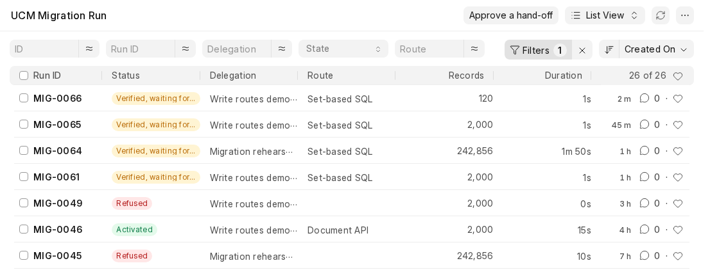
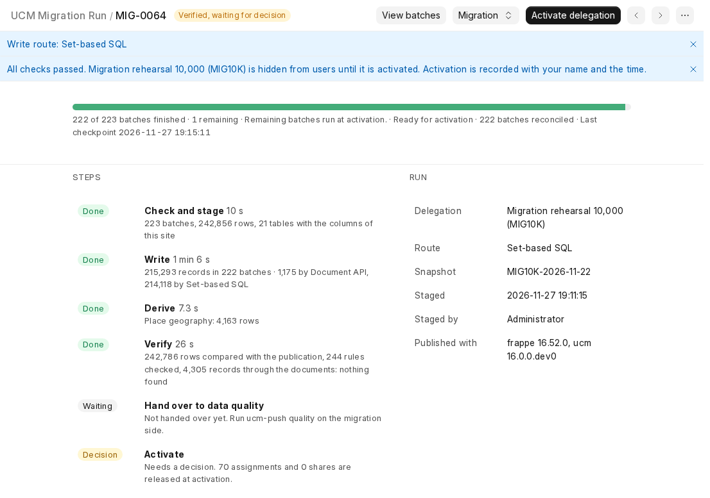
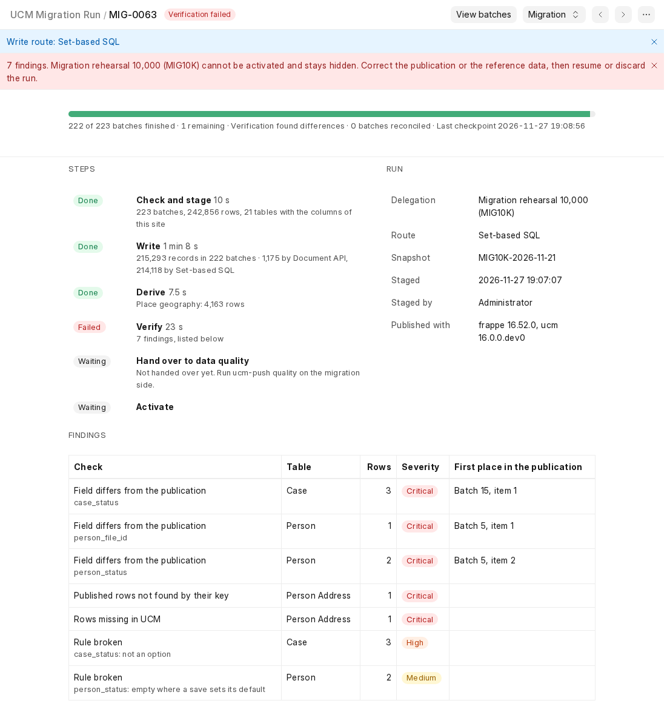
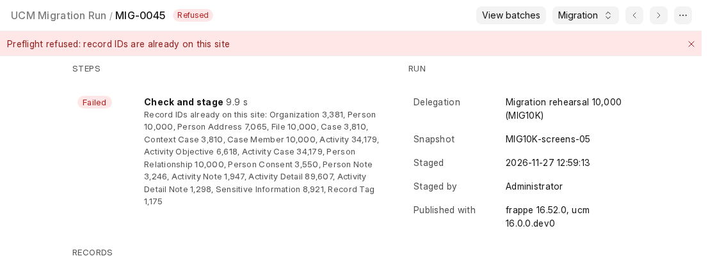
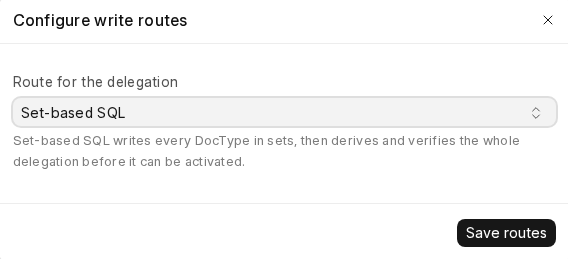

# Technical reference

For the people who run and maintain the loader. Operating a migration step by step, with its screens, is in the [user manual](user-manual.md); what the loader refuses or leaves out is in [Limits and edge cases](limits-and-edge-cases.md).

- [What the site must hold before a load](#what-the-site-must-hold-before-a-load)
- [What the sealing writes and refuses](#what-the-sealing-writes-and-refuses)
- [Operate the run in Desk](#operate-the-run-in-desk)
- [Hand the metrics to the data quality database](#hand-the-metrics-to-the-data-quality-database)
- [All CLI commands](#all-cli-commands)
- [Recovery](#recovery)
- [Set-based SQL route](#set-based-sql-route)
- [Operating larger publications](#operating-larger-publications)

## What the site must hold before a load

Provision UCM's shared dictionaries, referenced catalogs, historical users, sensitive-field policy, context exemptions and intended access grants. The loader does not load this reference data: a publication carries the delegation's own records only. Before the first batch is written, the load checks that everything those records refer to outside the publication is on the site. Where something is missing the run pauses with nothing written, and its form names the DocType. UCM document sharing must be disabled in System Settings. For the first delegation these prerequisites may need initial setup. For later delegations, prepare the incoming context while existing contexts remain active. The user manual lists what a publication carries and what the site must hold, and how each is checked: [What the site must hold before a load](user-manual.md#what-the-site-must-hold-before-a-load).

## What the sealing writes and refuses

A batch holds up to 1,000 parent documents and 4 MiB, which is also the default of both ways of sealing. The first limit reached closes the batch. Child rows belong to their parent. The planner orders activities by dependency. A 1,000-person batch can produce one multi-row Person SQL statement when the records fit and have no dependencies requiring an earlier flush. Private picture bytes are sealed with their metadata. Supply `--ucm-version` to `prepare` if the publishing database lacks installed UCM version metadata.

`prepare` and `seal` refuse a delegation the site could not load, before they write a file: activities that lack a required place, business rows outside the publication profile, and persons whose files are not their picture alone. A publication carries a person's picture, as one private file, and no other attachment. The refusal gives the number of files and persons and the first person's identifier, and `source-inventory` lists the same under `unsupported_person_files`, so that the source is corrected before anything is sent. The site checks the same when it loads a person, and says so on the run.

## Operate the run in Desk

1. Search Desk for **UCM Migration Run** and open the staged run. Choose **Migration → Configure write routes**. Either set **Route for the delegation** to **Set-based SQL**, which loads the whole delegation in sets (see [Set-based SQL route](#set-based-sql-route)), or leave it at **Chosen per DocType** and select, for example, **Validated bulk SQL** for Person and **Document API** for Person Note. Click **Save routes**. All published parent DocTypes support either per-DocType route. The saved plan locks once apply starts, and the form shows it as **Write route**.
2. Choose **Migration → Apply hidden batches**. **Refresh progress** shows committed and remaining batches. **View batches** opens receipts for this run. Open an individual receipt to see its sequence, published DocType, actual write route and digest.
3. When the run is **Verified, waiting for decision**, read the overview on the form, and choose **Download report** for the whole record. The worker compares counts, stored fields, child order, historical audit fields, attachments and references against the publication. Deferred assignments and shares are counted separately. A failed check blocks activation.
4. After review, choose **Activate delegation**. Activation rechecks the import, releases eligible assignments and shares, and opens the context. **UCM Migration Held Share** records historical shares whose receiving delegation is inactive. UCM rechecks consent and eligibility when that delegation goes live. Once the delegation is open, the site removes its copy of the sealed file: the run keeps its report and its receipts, and a held share keeps what its release needs. The worker opens the delegation after the request; the form follows it and shows the open delegation without a refresh.

### What the list and the form show

The **UCM Migration Run** list has one row per run: its short ID, a state, the delegation, the route, the records published and the time the load worked. The state reads as the migration team needs it: **Proposed, to approve**, **Waiting for the file**, **Staged**, **Loading, 62 %**, **Paused**, **Verification failed**, **Verified, waiting for decision**, **Activated**, **Discarding**, **Discarded** or **Refused**. Filter by delegation, state or route. A script reads the state as it is stored, in the answers of `ucm-push`: `Proposed`, `Awaiting publication`, `Publication staged`, `Publication applying`, `Publication paused`, `Publication ready`, `Publication cleaning`, `Activated`, `Discarded` or `Rejected`.



A run's form opens on an overview, read from what the run keeps and refreshed every ten seconds while the run waits for its file, or a load or a discard is at work. The actions are offered to a Migration Admin; who only reads the run sees the overview and no action:

- **Steps**: check and stage, write, derive (set-based route), verify, hand over to data quality, activate, and discard where there was one. Each has a status, the time it took, and one line of figures.
- **Run**: delegation, route, snapshot, who proposed, approved and staged it and when, the application versions the publication was made with.
- **Records**: the rows of each table in the publication and in UCM, and their difference. Assignments and shares are held until activation; afterwards the table shows how many were released and how many shares are kept for delegations that are not live yet.
- **Findings**, when a verification found something: the check, the table, the rows, a severity and the first place in the publication (batch and item). No record ID and no field value is shown. Resolve a place on the publishing host with `ucm-push locate-item`.

A load or a discard whose job is gone says so in red above the overview, with the batch it had reached: the form looks the run up in the migration queue once its worker has been quiet for a minute. The list keeps showing **Loading**; open the run to see it.

A run that waits for the go-live decision says so above the overview and offers **Activate delegation** as its main button. The form has no **Save**: a run changes through its actions only.



A run whose verification found something stays paused and hidden, whatever the severity of the findings:



A sealed file the site refuses at staging is kept as a **Refused** run, so that the refusal is not only a line in a terminal. It shows what differs: the tables whose columns differ from this site, the application versions, or the record IDs that are already there. A refused run holds no staged file and no rows; the file that arrived is kept beside the staged ones. Staging it again, after the cause is corrected, checks it from the start and continues in the same run. **Migration → Remove arrived file** removes it where the publication itself is wrong: the run stays, and says who removed its file.



## Hand the metrics to the data quality database

The UCM site connects to nothing on the migration side. The publishing host asks the site for a run's metrics and stores them where the migration team keeps its own, so that the source, the migration database and the target can be reconciled in one place.

```bash
ucm-push quality "${remote[@]}" --quality-config /etc/ucm-migration/quality-db.json
ucm-push quality "${remote[@]}" --quality-out "$RUN_ID-metrics.csv"
```

- `--quality-config` is a private PyMySQL connection JSON, as `--source-config` ([sample](../samples/quality-db.json)). The rows go into the table `ucm_target_metric` (`--quality-table` names another; `--create-quality-table` creates it when it is absent). A run's rows replace the rows the same run left before, in one transaction, so the command can be repeated after every step.
- `--quality-out` writes the same rows to a file: CSV for a `.csv` name, JSON otherwise. Both options can be given together.
- The site then records on the run that the metrics were stored, by which account and where (the table's or the file's name, nothing else). The form shows it as the step **Hand over to data quality**. The record is refused when the run has changed since the metrics were read. A hand-over counts for the metrics the run holds at that moment: after a later step, such as the activation that releases the assignments and shares, the form shows the step as due again until the command is repeated.
- The account that sent a run's sealed file may read the status, the report and the metrics of that run, and of no other. A Migration Admin's token works for every run.
- Set `ucm_migration_quality_url` in the site config to a link containing `{run}` (and `{context}` where the dashboard needs it), and the form offers **Open in data quality dashboard**. A running site reads the setting within a minute.

Each row carries the run, site, context, context code, snapshot, route, state and the time of the run's last change, then:

| Category | Metric | Per | Passes when |
|---|---|---|---|
| Completeness | Number of records, Lost records | table | the target holds every published row |
| Completeness | Access rows held for activation | assignments, shares | informative until activation; afterwards released plus held equals published |
| Field-level accuracy | Exact match per field | table | no stored column differs from the publication |
| Field-level accuracy | Hash exact match | run | the batch receipts chain to the publication's digest |
| Referential integrity | Integrity rule broken | table and rule | listed only when broken |
| Referential integrity | Integrity rules broken, Sampling validation | run | no rule is broken; every sampled record passed the document check |
| Cross-cutting | Errors count by severity | severity | zero |
| Cross-cutting | Migration time, seconds | step | informative |

Severities follow the scale of the migration's quality metrics. A missing row, a field that differs, a link to nothing or out of the delegation is **CRITICAL**; a value outside its list, a missing required value or any other broken rule is **HIGH**; a default left empty is **MEDIUM**. This mapping is the loader's reading of that scale and is one table in `data_quality.py`. The loader itself does not weigh severities: any finding keeps the run paused.

```sql
create table if not exists `ucm_target_metric` (
	run char(64) not null, site varchar(140) not null, context varchar(140) not null, context_code varchar(140),
	snapshot varchar(140) not null, route varchar(60), state varchar(60), generated_on datetime(6) not null,
	category varchar(60) not null, metric varchar(80) not null,
	entity varchar(140) not null default '', rule varchar(190) not null default '',
	source_value decimal(30, 6), target_value decimal(30, 6), value decimal(30, 6),
	target varchar(60), severity varchar(20), passed tinyint,
	primary key (run, category, metric, entity, rule)
)
```

## All CLI commands

The examples of the detailed commands reuse the Bash arrays and variables that [docs/detailed-commands.md](detailed-commands.md) sets, where those commands are shown in order. For operator actions, run in a separate shell with the same target variables and a **Migration Admin's** token. Commands such as `apply` enqueue work. Poll `status` for the resulting state.

| Command | What it does | Example |
|---|---|---|
| `init` | Short way: write the settings file and the two connection files, to fill in | `ucm-push init /srv/migration` |
| `seal` | Short way: inventory, sealed file and hand-off for one delegation, by its code | `ucm-push seal DEMO01` |
| `propose` | Short way: put a sealed publication's hand-off before the site's migration team, and print its check code | `ucm-push propose DEMO01-2026-11-27` |
| `send`, `sent` | Short names of `send-publication` and `transfer-status` | `ucm-push send DEMO01-2026-11-27` |
| `source-inventory` | Count source rows and identify unsupported business rows | `ucm-push source-inventory "${src[@]}"` |
| `upload-order` | Preview activity dependency order and batch planning | `ucm-push upload-order "${src[@]}" --batch-size 1000` |
| `prepare` | Write a sealed delegation publication to a new file | `ucm-push prepare "${src[@]}" --private-files "$PRIVATE_FILES" --publication-out "$PUBLICATION" --batch-size 1000 --batch-bytes 4194304` |
| `check-publication` | Verify the sealed file, site, manifest and digest, and emit the handoff | `ucm-push check-publication --site "$TARGET_SITE" --publication "$PUBLICATION" --run "$RUN_ID"` |
| `send-publication` | Upload the approved file, resuming from the acknowledged offset | `ucm-push send-publication "${remote[@]}" --publication "$PUBLICATION" --progress` |
| `transfer-status` | Read expected byte count and acknowledged offset | `ucm-push transfer-status "${remote[@]}"` |
| `apply` | Start or resume applying committed business batches. Optionally stop after a bounded number of new batches | `ucm-push apply "${remote[@]}" --max-batches 1` |
| `status` | Show run state, received and applied counts, and the first finding | `ucm-push status "${remote[@]}"` |
| `pause` | Stop the worker at a batch boundary | `ucm-push pause "${remote[@]}"` |
| `report` | Read reconciliation, held-share outcomes and activation details | `ucm-push report "${remote[@]}" > report.json` |
| `quality` | Store the run's data quality metrics in a table or a file on the publishing side, and record the hand-over on the run | `ucm-push quality "${remote[@]}" --quality-config quality-db.json` |
| `locate-item` | On the publishing host, resolve a finding's one-based batch and item to its source record | `ucm-push locate-item --site "$TARGET_SITE" --publication "$PUBLICATION" --run "$RUN_ID" --sequence 2 --item 1` |
| `activate` | Request activation of a reviewed ready delegation | `ucm-push activate "${remote[@]}"` |
| `discard` | Cancel a hidden run and remove its imported rows while retaining receipts | `ucm-push discard "${remote[@]}"` |

The CLI accepts the legacy spellings `activity-order` for `upload-order` and `freeze` for `prepare`. Run `ucm-push --help` for every flag.

## Recovery

| Situation | Operator action |
|---|---|
| Upload interrupted | Check `transfer-status` and repeat `send-publication` using the same approved file and digest. |
| Paused or not activated, with *Published … fields differ on target* and the fields' names | UCM on this site stores those fields otherwise than the publication holds them: a rule of UCM fills or changes them, or this UCM no longer has them. Check that the site runs the UCM release the publication was made for; the finding names the fields, never their values. |
| Apply interrupted | Check `status` or the run's **Finding**. Each successful business batch and its receipt commit together. Resume with `apply` after correcting the reported issue. |
| Source data needs correction | Review and discard the hidden run, correct the source, then prepare a new publication under a new snapshot name. |
| Write-route menu missing | Open a **Staged** run, before its first load. |
| Staging refused | Open the **Refused** run the staging left: its first step says what differs. Correct the site (release, reference data), then choose **Migration → Stage now**. Where the publication itself is wrong, choose **Migration → Remove arrived file** (or `ucm-push discard`) and prepare a new publication: nothing else removes the file that arrived for a refused run. |
| The form says **No job is working on this load** (or discard) | The job's process was killed or its worker went down. The run kept its state and nothing is half written: every batch with a receipt is stored whole, and the rows of the batch that was being written are gone. Choose **Migration → Resume from last receipt** (or **Resume cleanup**): the load goes on after the last receipt, and the verification after the last batch it had compared. |
| Paused with `apply after committed batch N: OperationalError` | The job lost its database connection, and took a new one to record it. Check the database, then **Resume from last receipt**. |
| Set-based run paused with **Verification found** | Open the run: **Findings** lists each check with its severity, and each field that differs with the batch and item of its first occurrence; resolve it with `locate-item`. The downloaded report holds the same under `findings`. Correct the cause and resume: the delegation is derived and verified again from the first batch. If the publication itself is wrong, discard the run. |
| Ready but some batches remain | Inspect the report's deferred access counts. Eligible assignments and shares are handled during activation. |

[Developer rehearsals, reference-data checks, test commands and benchmark procedures](../REHEARSALS.md)

## Set-based SQL route

The document routes save every published record through its controller, about a hundred records a second. The set-based route copies the published rows into UCM's tables with multi-row inserts and applies the rules afterwards, over the whole delegation. A 10,000-person delegation of 243,000 rows was loaded and verified in two to four minutes by this route, where the Document API route took 40 to 50 and six more to activate, with the same stored rows. The times were measured on a development site on different days, and vary with what else the site holds ([measurements](../REHEARSALS.md#set-based-sql-route)).

Choose it per run in **Configure write routes**, or from the receiving bench:

```sh
bench --site "$TARGET_SITE" execute ucm_migration_loader.write_routes.select \
  --kwargs "$(jq -nc --arg run "$RUN_ID" '{run:$run, route:"Set-based SQL"}')"
```



To make it the route every newly staged run starts with, set it on the site. An operator can still change a staged run before its first apply.

```sh
bench --site "$TARGET_SITE" set-config ucm_migration_route "Set-based SQL"
```

Everything else is operated as before: **Apply hidden batches**, **Pause after current batch**, **Resume from last receipt**, **Activate delegation** and **Discard run** in Desk, or `apply`, `pause`, `status`, `report`, `activate` and `discard` with `ucm-push`. The run passes through these phases, shown beside the batch progress:

| Phase | What the worker does | Where it resumes |
|---|---|---|
| Writing *DocType* | Inserts the rows of up to 5,000 parent records per transaction, with their child rows, private pictures and batch receipts. Sensitivity tags are saved through their documents | After the last committed batch |
| Deriving | Sets the values a save would derive, for this delegation only: an activity's place type, country and areas from its Place, the department and country copies on history rows and notes, the share facts and the latest-state marks | Runs again; rows that already hold the value are not written |
| Verifying | Compares every stored column with the publication, batch by batch, and passes one record in fifty through the document route's own check | After the last compared batch |
| Ready for activation | Counts the delegation, counts the rows that break a rule a query can check (required fields, options, links, option sets and collections, links that leave the context, places, a relationship recorded twice, history locks), and compares the receipts with the publication. With no finding the run becomes **Verified, waiting for decision** and the report can be downloaded | — |

A job works for about two minutes on the batches and then hands over to the next job. A pause takes effect at the next transaction while writing and within about ten seconds while verifying, and a restarted worker loses at most one transaction. The live-load thresholds below pause this route as well. A failed step pauses the run with its finding; **Resume from last receipt** continues from the phase and batch it had reached.

Activation releases the held assignments and shares through their documents and opens the context in one transaction. Its job is given an hour, and ten minutes for every 100,000 rows where that is more: a job cut off by its time limit would lose the whole transaction, and meet the same limit when asked again. On this route it reads the row counts and receipts again; it does not read every record again, because the context has been locked and hidden since the verification. On the document routes the activation does read every record once more, about two and a half minutes for 100,000 rows on a development bench, in that one transaction: this route is the one for a large delegation. **Discard run** removes the delegation's rows by primary key, 5,000 at a time, on either route, and removes the site's copy of the sealed file.

To have more records checked through the documents, lower the sampling interval on the site; `1` checks every record, at the document route's speed for that phase.

```sh
bench --site "$TARGET_SITE" set-config ucm_migration_sample_every 10 --parse
```

Know these limits before choosing the route:

- No controller runs for a copied row. A controller rule that is not in the verification's list is checked on the sampled records only.
- The verification's list is a reading of UCM's rules as they were when the route was reviewed. The app's tests read the code a save runs in UCM for every table the route writes, and fail when it differs from the reviewed one (`ucm_rules.py`, `ucm_rules_reviewed.json`); see [Tests](development.md). A UCM that has changed since is reviewed before the route is used with it.
- The route runs on a UCM with or without the home's record counts (`ucm.permissions.counts`): where UCM keeps them, they move with the rows written or removed.
- A private picture keeps its published file name. The document routes may store the same bytes under another name.
- Assignments and shares are released in one transaction at activation, as on the document routes. A delegation with 11,000 shares had an activation of about three minutes.
- A share that UCM's current rules no longer allow stops the verification, with its batch and item in the finding. Correct the consent or the publication and resume.
- The largest delegation loaded by this route had 1.25 million rows and was loaded and verified in 10.5 minutes on a quiet development site, and in 13 minutes while eight simulated caseworkers worked in other delegations without a failed request or a lock wait. A discard disturbed them more than a load did: schedule it, like a load, outside the busiest hours. Rehearse a delegation of the expected size on a production-like environment before relying on the figures.

## Operating larger publications

After updating an existing receiver, run `bench --site TARGET migrate` and restart the web processes and workers. Open the migration run in Desk to see the last worker checkpoint, phase and reconciled batch count. Open a business batch receipt for its parent row count, publication and attachment bytes, write time, measured validation time, attachment time and reconciliation time. Validation and attachment work can take place inside the write phase, so these durations overlap.

Staging verifies the entire SQLite file, keeps it in the site's `private/migration-publications` folder, readable by the bench's account only, and builds a private index of its approved batch hashes. The file and its index stay until the run is activated or discarded, and are removed then. Workers check the sealed file identity and the next batch hash. If a site restore changes the file identity, an operator can rebuild the index after verifying the restored file against the original manifest:

```sh
bench --site TARGET execute ucm_migration_loader.publication_receiver.rebuild_index --kwargs '{"run":"RUN_DIGEST"}'
```

Reconciliation saves progress after at most 25 business batches, or at a batch boundary after ten seconds. Resume a paused apply from Desk after reviewing its finding. Activation checks the inventory and access policy again. For simple Person and Person Note batches with a prior successful check, the worker locks the current records and compares their fingerprint. Changed batches and batches with complex relationships or files receive the full check.

Operators can set thresholds per receiving site. The following example pauses apply when observed live read or write p95 exceeds 500 ms, or when more than two database row lock waits are active. Set values from the site's measured traffic and agreed service targets.

```sh
bench --site TARGET set-config ucm_migration_live_p95_ms 500 --parse
bench --site TARGET set-config ucm_migration_max_lock_waits 2 --parse
```

The latency check uses up to 256 recent samples per read/write category from resource, v2 document and Desk form endpoints in the previous minute. The lock counter covers the whole MariaDB server. Both checks are optional. The worker evaluates them between business batches and reconciliation slices. A paused run requires an operator to resume it. Activation is a single transaction and should be timed separately when qualifying a live delegation.
