<!-- Built from user-manual.src.html by docs/build_manual.py. Edit the source, then build. -->

# UCM Migration Loader

*User manual for the publishing operator, the migration team and the site administrator · Frappe v16*

The same manual in one file, to read without the repository: [user-manual.html](user-manual.html).

- [How a delegation moves](#how-a-delegation-moves)
- [What the site must hold before a load](#what-the-site-must-hold-before-a-load)
- [Prepare the site](#prepare-the-site)
- [Seal and send a delegation](#seal-and-send-a-delegation)
- [Approve the hand-off](#approve-the-hand-off)
- [Load the delegation in Desk](#load-the-delegation-in-desk)
- [Review what arrived](#review-what-arrived)
- [Hand the metrics to data quality](#hand-the-metrics-to-data-quality)
- [Go live, or discard](#go-live-or-discard)
- [When something goes wrong](#when-something-goes-wrong)
- [Reference](#reference)

## How a delegation moves

The loader brings one delegation at a time from the publishing database into a shared UCM site. The delegation travels as one sealed file. It is loaded into a context that stays locked and hidden, checked there against the file, and opened to its users only when someone decides so. The UCM site connects to nothing on the migration side: every exchange starts from the publishing host.

### In plain words

- **One file per delegation.** The publishing operator's command reads the delegation from the publishing database and writes it into one file. The file gets a fingerprint: a number computed from its whole content, which is another number as soon as one byte differs.
- **The site agrees before it receives.** The operator first sends a summary only: which delegation, how many records, the file's size and its fingerprint. A Migration Admin approves it. From then on the site accepts that one file, from that one account, and no other.
- **The file travels in small pieces, over HTTPS.** A transfer that is interrupted goes on where it stopped. When the last piece has arrived, the site compares the whole file with the fingerprint that was approved.
- **The site sets the file aside.** It holds it once, in a private folder that no web address reaches, and never changes it. The run is then *staged*: nothing is in UCM yet.
- **Loading copies the records into UCM, out of sight.** They are written into the delegation's context, which stays locked and hidden. Every stored record is then compared with the file.
- **A person decides.** Activating opens the delegation to its users. Discarding removes every record of it. Either way the site then deletes its copy of the file.

### Who does what

| Who | Works in | Does |
|---|---|---|
| **Publishing operator** | A terminal on the publishing host, with `ucm-push` | Seals the delegation into a file, proposes its hand-off to the site, sends the file, and collects the run's metrics. |
| **Migration team** | The UCM Desk, with the **Migration Admin** role | Approves the hand-off, chooses the write route, loads, reviews the verification, and activates or discards. |
| **Site administrator** | The server | Installs the app, runs the migration worker and gives the two roles: Migration Admin and Migration Publisher. See [Prepare the site](#prepare-the-site). |

1. **Seal and propose.** The publishing operator seals the delegation and proposes its hand-off to the site: a summary of the sealed file, without the file.
2. **Approve and stage.** A Migration Admin approves the proposal in the Desk, with a check code the publishing operator tells them. The file is sent, and the site checks and stages it by itself. A file that does not fit the site is refused, with the reason.
3. **Load.** The migration team loads the staged run. Its rows are written, UCM's derived values are computed, and everything is verified against the file.
4. **Review.** A run with no finding waits for the decision. A run with findings stays paused and hidden.
5. **Hand over.** The publishing operator collects the run's metrics for the data quality database.
6. **Decide.** The migration team activates the delegation, or discards the run.

### Where the delegation's data is

| When the run is | On the UCM site |
|---|---|
| **Proposed, or approved and waiting for the file** | A summary of the file: the delegation, the number of records, the size and the fingerprint. No record. |
| **Staged** | The sealed file, in the site's private folder. Nothing in UCM. |
| **Refused** | The file as it arrived, so that it can be checked again, until a Migration Admin removes it. Nothing in UCM. |
| **Loading, paused or verified** | The sealed file, and the records in UCM, hidden from every user. |
| **Activated** | The records in UCM, open to the delegation's users. The file is deleted. |
| **Discarded** | Neither records nor file. The run stays as a record of what was done. |

The sealed file on the publishing host is not touched by any of this. It stays there until the publishing operator removes it.

Search the Desk for **UCM Migration Run** to see every run with its state. Open a run by its short ID, such as `MIG-0063`. Commands use the run's full identifier, a 64-character digest.

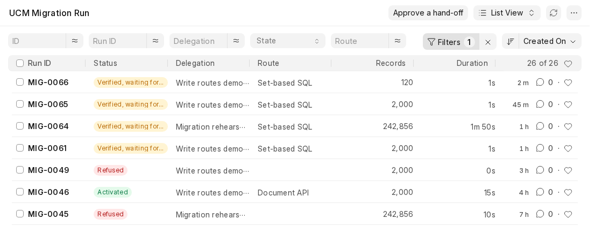

*The list shows each run's state as the team reads it. Filter by delegation, state or route.*

> **Until activation nothing is visible.** A loading, paused or verified delegation is hidden from every UCM user. Activation is the only step that cannot be taken back.

## What the site must hold before a load

*For the migration team and the site administrator.*

A publication carries a delegation's own records and nothing else. Everything those records depend on is expected on the UCM site already. Most of it is shared by all delegations; a few items, such as a delegation's exemptions, belong to one.

| Carried in the publication |
|---|
| Organizations, persons with their other names, addresses and pictures, cases and their members, activities with their objectives, details and notes, relationships, consents, sensitive information, the tags on records, assignments and shares. |

| Must be on the site | How the load checks it |
|---|---|
| **Dictionary terms, protection departments, field clearances** | Each one a record refers to is found on the site by what identifies it: a department by its code, a clearance by its name. Its name, kind and description must be those published. |
| **Catalogs: place types, activity types, service types, objectives, sensitivity tags, countries, places** | Each one a record refers to must exist on the site under the published identifier. |
| **Users named in the records: who created or changed a row, who a task is assigned to, who a share is for** | Each is found on the site by e-mail address, with the published full name. |
| **Which field needs which clearance, and the delegation's exemptions** | The publication holds a copy. The site's setup is compared with it before the first write, at the verification and again before activation. |
| **Teams, their security profiles, and the tags each user may access** | Not checked. This is the site's own setup. |

### When something is missing

The check runs before the first batch is written. Where it fails the run becomes **Paused** with nothing written, and the notice on its form says what the site lacks, for example:

```text
apply after committed batch 0: A Field Clearance the delegation refers to is not on this site
```

The notice names the kind of record, never a record or a value. Have the site administrator add what is missing, or correct what differs, then choose **Migration → Resume from last receipt**: the check runs again from the start.

> **The load does not check who will see the delegation.** It confirms that the users named in the records exist, not that they have the team, the profile or the tag clearances they need. After activation, access follows the site's own setup: review it before you activate.

## Prepare the site

*For the site administrator, on the UCM server. Done once, before the first delegation.*

### 1. Install the app

UCM is installed on the site already. The loader runs on Frappe version 16 as released: it needs no change to the framework. In place of `https://github.com/ORGANISATION/REPOSITORY.git`, give the address of your organisation's repository of the loader.

```sh
bench get-app ucm_migration_loader https://github.com/ORGANISATION/REPOSITORY.git
bench --site ucm.example.org install-app ucm_migration_loader
bench --site ucm.example.org migrate
```

The Desk now has three lists, **UCM Migration Run**, **UCM Migration Batch** and **UCM Migration Held Share**, and the site has two more roles.

### 2. Start the migration worker

Staging, loading, activating and discarding are done by a worker that takes its jobs from a queue of its own, `ucm_migration`. A migration then does not wait behind the site's other jobs, and they do not wait behind it. Add the queue to `sites/common_site_config.json`, inside the `workers` entry if the file has one already:

```json
{"workers": {"ucm_migration": {"timeout": 300, "background_workers": 1}}}
```

Then restart the bench's processes, the way this server runs them, so that the worker starts. To try it in a terminal:

```sh
bench worker --queue ucm_migration
```

One worker does one job at a time: two delegations that are loading take turns. The loader has been run with one worker.

> **Without this worker nothing moves.** A file that has arrived is not staged, and a load that was asked for does not start: its form says that no job is working on it.

### 3. Give the roles

| Role | Give it to | Where |
|---|---|---|
| **Migration Admin** | Each member of the migration team who approves, loads, activates or discards. | The person's **User** record, under **Roles**. |
| **Migration Publisher** | Each publishing account, so that it may propose its hand-offs. | The account's **User** record, under **Roles**. |

Keep the two apart. A Migration Admin cannot approve a proposal of their own account, nor of another Migration Admin's: the one who sends and the one who approves are two. A System Manager without the Migration Admin role reads the runs and cannot act on them.

### 4. Make a publishing account

1. Create a **User** for the publishing host. It needs no access to the Desk: a website user is enough.
2. Give it the **Migration Publisher** role.
3. In the user's **Settings**, under **API Access**, generate its keys.
4. Pass the key and the secret to the publishing operator by a safe way. They keep them on one line, as `key:secret`, in the token file their settings name.

An approval names the one account that may send the file. Give each publishing operator an account of their own, so that a run says who sent it.

### 5. Check the address and the disk

| Check | Why |
|---|---|
| **The site answers over HTTPS** | `ucm-push` sends to no other kind of address. Where the site's certificate comes from a private authority, give that authority's certificate to the publishing operator. |
| **Requests of one megabyte pass** | The file arrives in pieces of half a megabyte, each a little larger once it is put into a request. A proxy in front of the site must let them through. |
| **The private folder has room** | The site holds each sealed file once, until its run is activated or discarded. An approval is refused when the disk has less free than the file's size and 64 MB. |

What the loader keeps on the server, outside the database, in the site's folder:

| Folder | Holds |
|---|---|
| `private/migration-publications` | The sealed file of each run that is arriving, staged, loading or refused. A whole copy of a delegation, not encrypted, readable by the bench's account only. Removed when the run is activated or discarded, and when a Migration Admin removes a refused run's file. |
| `private/migration-inbox` | For each approved run, the approval and how far its file has arrived. A few hundred bytes. |

> **A site backup does not hold these folders.** A backup with files takes `private/files` and `public/files` only. After a site is restored, a run that was staged or loading has no file: have the migration team discard it, and the publishing operator seal and send the delegation again. An activated delegation needs no file.

### 6. Take a newer version

```sh
git -C apps/ucm_migration_loader pull
bench --site ucm.example.org migrate
```

Then restart every process of the bench, the migration worker included: a worker keeps the code it started with. Choose a moment when no run is loading. A job the restart cuts off loses nothing that was stored: the migration team resumes the load from its form.

### Keep an eye on

- **The worker.** A run whose form says that no job is working on it means the worker is down or was restarted. Start it, and tell the migration team to resume.
- **The disk.** A refused run keeps the file that arrived until someone removes it, and a run that nobody activates or discards keeps its file as well.
- **The settings.** The limits that pause a load for the site's users, and the link to the data quality dashboard, are under [Settings of the site](#reference).

## Seal and send a delegation

*For the publishing operator, on the publishing host.*

### 1. Install the command, once

Use Python 3.11 or newer. The command works without a bench. In place of `https://github.com/ORGANISATION/REPOSITORY.git`, give the address of your organisation's repository of the loader; you need read access to it.

```sh
git clone https://github.com/ORGANISATION/REPOSITORY.git ucm_migration_loader
cd ucm_migration_loader
python3 -m venv .venv
. .venv/bin/activate
python -m pip install .
ucm-push --help
```

To take a newer version later, run `git pull` in that folder and `python -m pip install .` again.

### 2. Write the host's files, once

The host keeps three small files. This command writes them into the folder you name, readable by your account only, for you to fill in. The repository's `samples` folder shows the same files.

```sh
ucm-push init /srv/migration
```

| File | Holds |
|---|---|
| `ucm-push.toml` | The settings: what is the same for every delegation. |
| `source.json` | The connection to the publishing database, for an account that only reads. |
| `quality-db.json` | The connection to the data quality database, for an account that writes the metrics table. Only if you write metrics to a database. |

**The settings**, `ucm-push.toml`. Passwords and tokens are not written in it: it names the private files that hold them.

```toml
# the receiving site, as its bench names it, and its HTTPS address
site = "ucm.example.org"
url = "https://ucm.example.org"

# the read-only connection to the publishing database, and the pictures of the published persons
source_config = "/srv/migration/source.json"
private_files = "/srv/publication/private/files"

# a folder per snapshot is made here
publications = "/srv/migration/publications"

# key:secret of your publishing account, on one line
token_file = "/srv/migration/ucm-token"

# optional: the data quality database
quality_config = "/srv/migration/quality-db.json"
```

**The two connections**, `source.json` and `quality-db.json`, have the same form: where the database server is, the account, and the database.

```json
{
	"host": "publisher-db.example.org",
	"port": 3306,
	"user": "migration_reader",
	"password": "<password of the read-only account>",
	"database": "ucm_publication"
}
```

| Key | Meaning |
|---|---|
| `host`, `port` | Where the MariaDB server listens. |
| `user`, `password` | The account that connects. For `source.json`, one that may only read the publishing database. For `quality-db.json`, one that may read, insert and delete in the metrics table. |
| `database` | The database to read, or to write the metrics to. |
| `unix_socket` | For a server on the same host: the path of its socket, in place of `host` and `port`. |
| `ssl_ca`, `ssl_verify_cert` | To connect over TLS: the certificate of the authority that signed the server's, and `true` to refuse a server that does not verify. |

**The token file** named by `token_file` is one line: the API key and secret of your publishing account on the UCM site, as `key:secret`. Make it readable by your account only (`chmod 600`): the command refuses it otherwise. For a private certificate authority, add `ca_bundle` to the settings with the path of its certificate.

### 3. Seal the delegation

Give the delegation's code. The command checks what the delegation holds, seals it with its pictures into a new folder named after the code and the date, checks the sealed file, and writes the hand-off.

```sh
ucm-push seal DEMO01
```

```text
Sealed DEMO01 (Synthetic delegation) as snapshot DEMO01-2026-11-27
  Folder       /srv/migration/publications/DEMO01-2026-11-27
  Rows         2,000 in 2 batches
               Person 1,000 · Person Note 1,000
  File         delegation.sqlite, 2.2 MB
  Fingerprint  ae064673bb9551a31fafb7dcd5830025d45527e36e76eea7edf11045463da38f
  Run          f1f73460c949fae6447f228bef70cd66254088acef7593afe39c1c29c9fe47ce

Next: propose it to the site, and send it once the migration team has approved:
  ucm-push propose DEMO01-2026-11-27
  ucm-push send DEMO01-2026-11-27
```

If the delegation cannot be sealed, the command says why in a sentence, for example that activities lack a place their type requires, or that persons have files attached beside their picture, and leaves what it found in the folder. Nothing was sent. Have the source corrected and seal again: every attempt gets a snapshot name of its own.

### 4. Propose the hand-off

The hand-off is the small file `handoff.json` in the snapshot's folder: the delegation, its row counts, and the size and fingerprint of the sealed file. Proposing sends it to the site, where it appears to the migration team as a run to approve. The sealed file stays with you until they have approved.

```sh
ucm-push propose DEMO01-2026-11-27
```

```text
Proposed to the site as MIG-0070.
Give the site's migration team this check code yourself: AE06-4673
They type it to approve. When ucm-push status says Approved, send the file: ucm-push send
```

Tell the check code to the person who approves, by a way that does not pass through the UCM site: a call or a message. The site never shows the code. It is the start of your file's fingerprint, so the approval holds for your sealed file and for no other.

> **Your account needs the Migration Publisher role to propose.** Without it, deliver `handoff.json` to the migration team by your agreed channel: they approve it from the file.

### 5. Send the file

1. Wait for the approval. `ucm-push status` answers *Proposed* until then, and afterwards that the site waits for the sealed file.
2. Send the file, by the snapshot's name. After an interruption, run the same command again: it continues where it stopped.
3. Ask where the run stands whenever you like.

```sh
ucm-push status DEMO01-2026-11-27
ucm-push send DEMO01-2026-11-27
ucm-push status DEMO01-2026-11-27
```

```text
Run f1f73460c949…: Approved: the site waits for the sealed file.
Sent: 2.2 MB, all of it. The site stages run f1f73460c949… by itself: ucm-push status shows when.
Run f1f73460c949…: Staged: checked, nothing written yet.
```

The site stages the file by itself once all of it has arrived: nobody has to be asked.

From inside the snapshot's folder the name can be left out: `ucm-push status`. Your account can read the runs it sent, and no other.

> **A sealed file is never changed, and a snapshot name is never used twice.** The site refuses a file whose content does not match the approved fingerprint. For scripts, every command answers in JSON when its output is redirected, or with `--json`.

## Approve the hand-off

*For the migration team, in the UCM Desk with the Migration Admin role.*

Before a file may arrive, a Migration Admin approves its hand-off: the summary the publishing operator proposes, which holds the delegation's row counts and the size and fingerprint of the sealed file. The sealed file itself never passes through your browser.

### 1. Open the proposed run

1. Search the Desk for **UCM Migration Run**. A proposed hand-off is a run that is **Proposed, to approve**.
2. Open it. The form says which account proposed it and when. Nothing is accepted for the run yet.

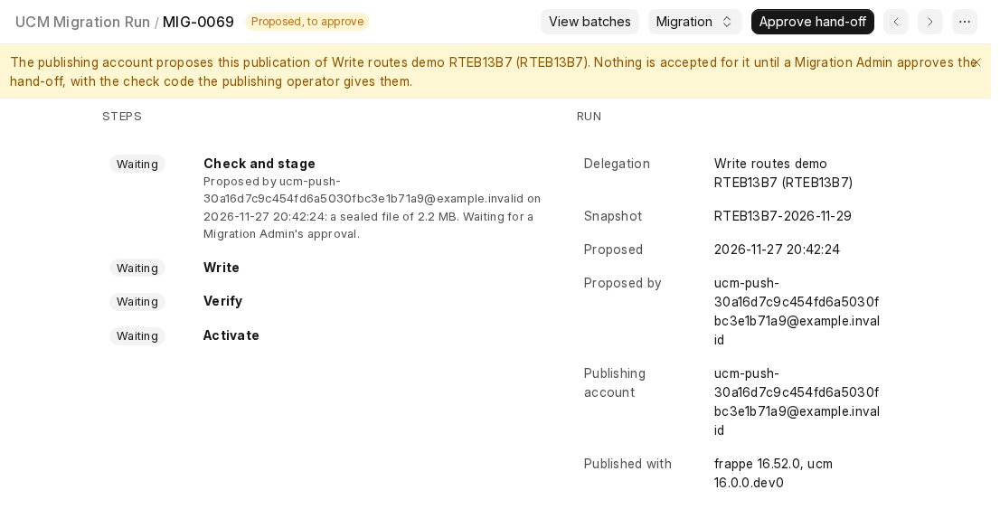

*A proposed run. It holds the hand-off and nothing else.*

### 2. Check it and approve

3. Click **Approve hand-off**. The dialog shows the delegation, the snapshot, the rows, the file's size and the account that proposed. Compare them with what the migration lead reviewed.
4. Read the line **Context**. A context that is locked, hidden and empty is ready. Where the site has none, check the **Code** and the **Name** below: the approval makes the context, locked and hidden. A context that is open, that holds records, or that another run holds, stops the approval, and the line says which.
5. Type the **Check code** the publishing operator told you, and click **Approve**.

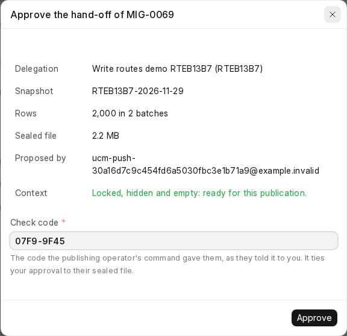

*The proposal as the dialog reads it. The check code is typed, never shown.*

> **Take the check code from the publishing operator, not from the site.** Their command printed it when they proposed. A code that does not match is refused: the proposal then is not the one they made, or the code was misheard. You cannot approve a proposal of your own account, nor of another Migration Admin's: the person who sends and the person who approves are two.

To turn a proposal down, choose **Migration → Decline**. The run becomes Discarded, and no file is accepted for it.

The approval makes the delegation's context and nothing else. The dictionaries, catalogs, users and sensitive-field setup the delegation refers to must be on the site before it is loaded: see [What the site must hold](#what-the-site-must-hold-before-a-load).

### 3. Wait for the file

The publication is now a run that is **Waiting for the file**. Its form shows who proposed it, who approved it, and how much of the file has arrived. The publishing operator's `ucm-push status` now answers *Approved*: they can send.

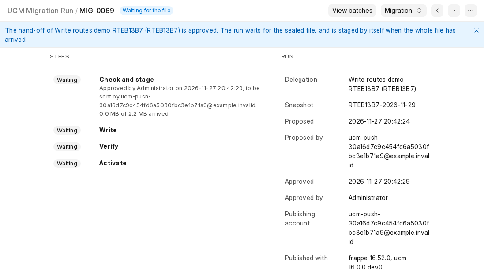

*An approved run. It is staged by itself when the whole file has arrived.*

When the whole file is there, the site checks it against the fingerprint and against this site, and the run becomes **Staged**, with nothing written. Nobody has to start this. To take an approval back before the file is staged, choose **Migration → Withdraw approval**: what has arrived is removed.

### A hand-off delivered as a file

A publishing operator whose account may not propose delivers `handoff.json` to you instead. On the list of runs, click **Approve a hand-off** and choose the file. The dialog shows the same summary and the file's fingerprint: compare the fingerprint with the one the migration lead reviewed. Choose the **Publishing account** that will send the file, which cannot be your own nor another Migration Admin's, and click **Approve**. The run then waits for its file as above.

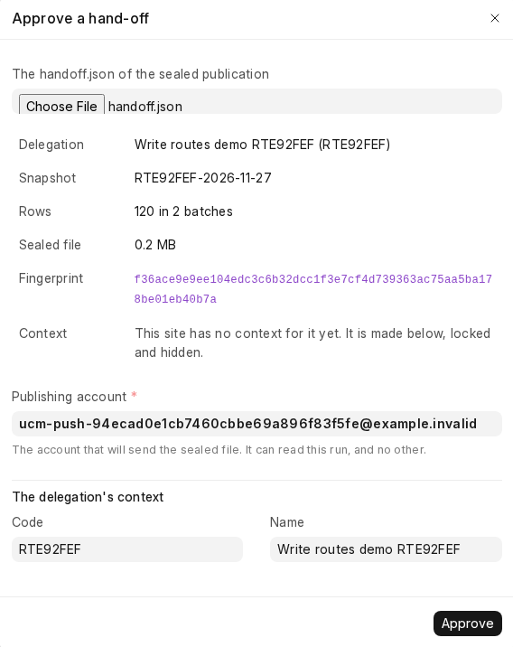

*A hand-off read from its file. Here the site has no context for the delegation yet, so its code and name are shown for the context that will be made.*

### A file the site refuses

The site refuses a file when its tables differ from the site's, when it was published with other application versions, or when its record IDs are already on the site. The run becomes **Refused** and holds no rows. The file that arrived is kept, unstaged, so that it can be checked again.

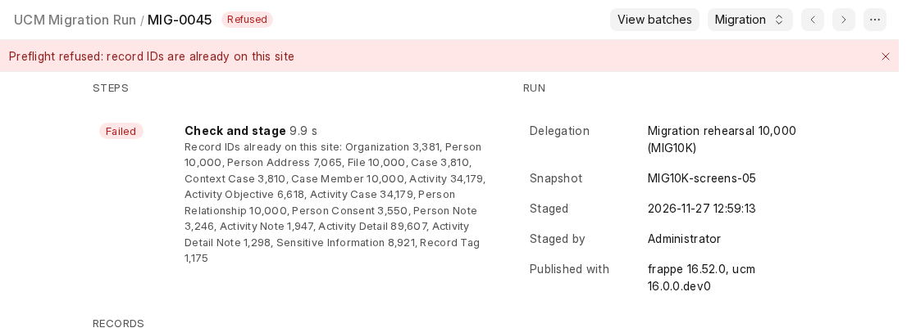

*A refused run says in its one step what differs. Here the delegation's record IDs were already on the site.*

Have the cause corrected, then choose **Migration → Stage now** on the refused run: the site's worker checks the file from the start, and it continues under the same run. The form shows the outcome when the worker has finished; for a large file that takes a while. If the publication itself is wrong, choose **Migration → Remove arrived file** and ask for a new one: the run stays as the record of the refusal, and says who removed its file.

## Load the delegation in Desk

*For the migration team, in the UCM Desk with the Migration Admin role.*

### 1. Open the staged run

Search the Desk for **UCM Migration Run** and open the run. Its form opens on the run's steps, each with a status, and on the run's facts: the delegation, the route, the snapshot and the versions it was published with. The form has no **Save**: a run changes through its actions only.

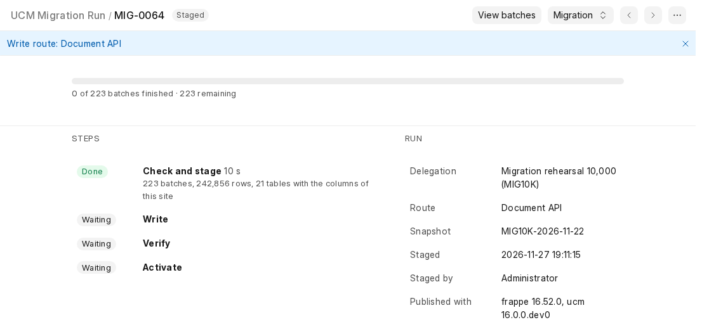

*A staged run: checked, and nothing written yet.*

### 2. Choose the write route

Every action on a run is in the **Migration** menu. Before the first load, choose **Configure write routes**.

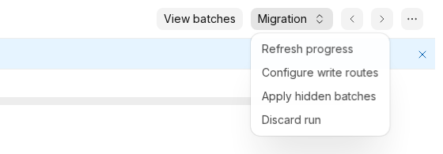

*The Migration menu of a staged run.*

| Route | What it does |
|---|---|
| **Set-based SQL** | Writes the whole delegation in sets, then derives and verifies it as a whole. The fast route, for the whole delegation or not at all. |
| **Document API** | Saves every record through UCM's own document logic, one at a time. The slowest and the most literal, for a small delegation: on a development bench 10,000 persons with their 243,000 rows took 40 to 50 minutes to load and 6 minutes to activate this way, against 2 to 4 minutes to load by the set-based route. |
| **Validated bulk SQL** | Chosen per DocType, beside the Document API, under **Chosen per DocType**. |

Set **Route for the delegation** as your migration lead has decided for this wave, and click **Save routes**. The route cannot be changed once the load has started.

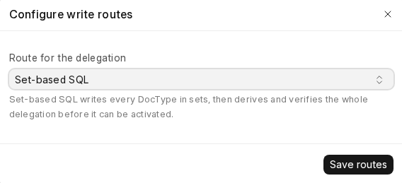

*One route for the whole delegation, or a route for each DocType.*

### 3. Start the load

Choose **Migration → Apply hidden batches**. A worker takes the run. While it works the form refreshes itself every ten seconds: leave it open, or come back later.

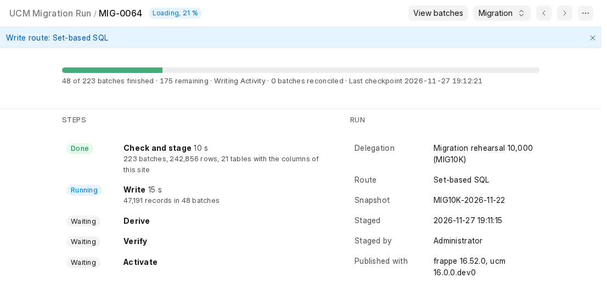

*A load at work. The bar counts the batches written, and each step shows its time once it is done.*

| Step | What happens |
|---|---|
| **Check and stage** | The file was read, compared with its fingerprint and checked against this site. |
| **Write** | The published rows are written, a group of batches at a time. Each group and its receipts are saved together. |
| **Derive** | Set-based route only: the values UCM computes on a save are computed for the delegation. |
| **Verify** | Every stored row is compared with the file, UCM's rules are checked, and a sample of records goes through UCM's own check. |
| **Hand over to data quality** | The run's metrics were collected by the publishing operator. |
| **Activate** | The delegation is opened to its users. |

To stop a load between two batches, choose **Migration → Pause after current batch**. **Resume from last receipt** continues it. A paused load keeps what it has written, hidden.

## Review what arrived

*For the migration team.*

### A run that passed

When the verification finds nothing, the run becomes **Verified, waiting for decision**. The banner says so, and **Activate delegation** appears as the form's main button.

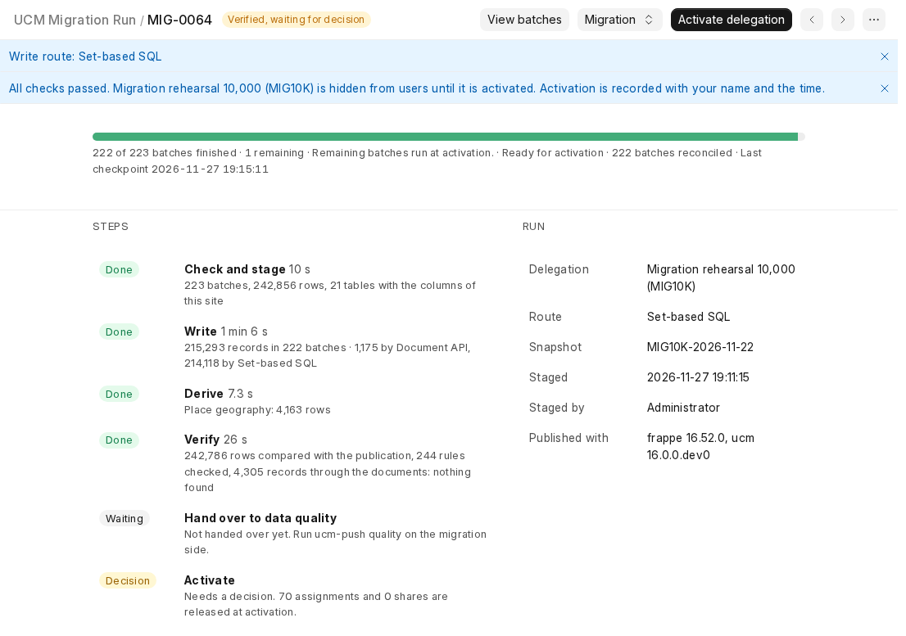

*All checks passed. The delegation stays hidden until someone activates it.*

Below the steps, **Records** lists each table with the rows published, the rows now in UCM and their difference. Assignments and shares are not written yet: they are released at activation.

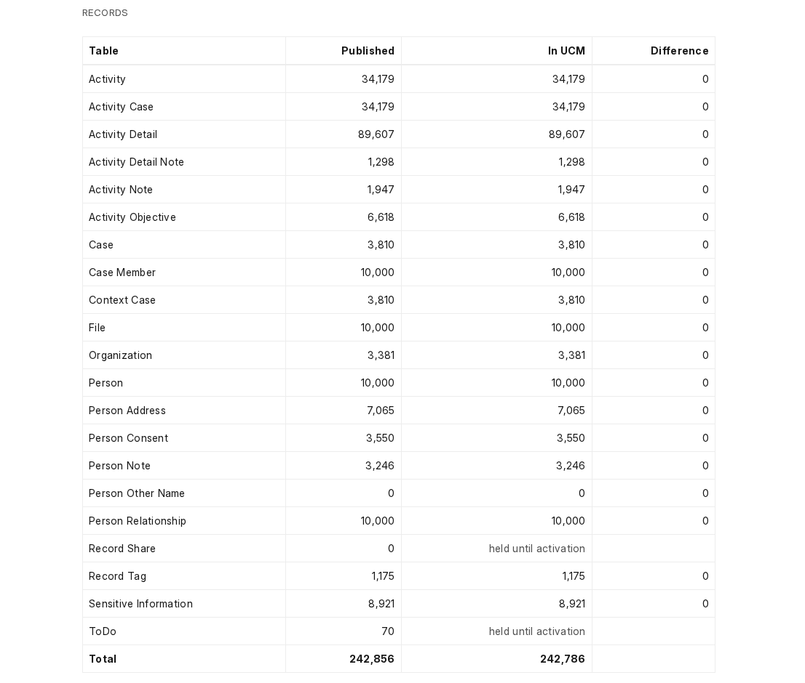

*Every difference should be zero. Assignments (ToDo) and shares (Record Share) show as held until activation.*

Choose **Migration → Download report** for the full record of the verification, to keep with the wave's sign-off.

### A run with findings

When the verification finds something, the run is **Verification failed**. It stays paused and hidden, and it cannot be activated, whatever the severity.

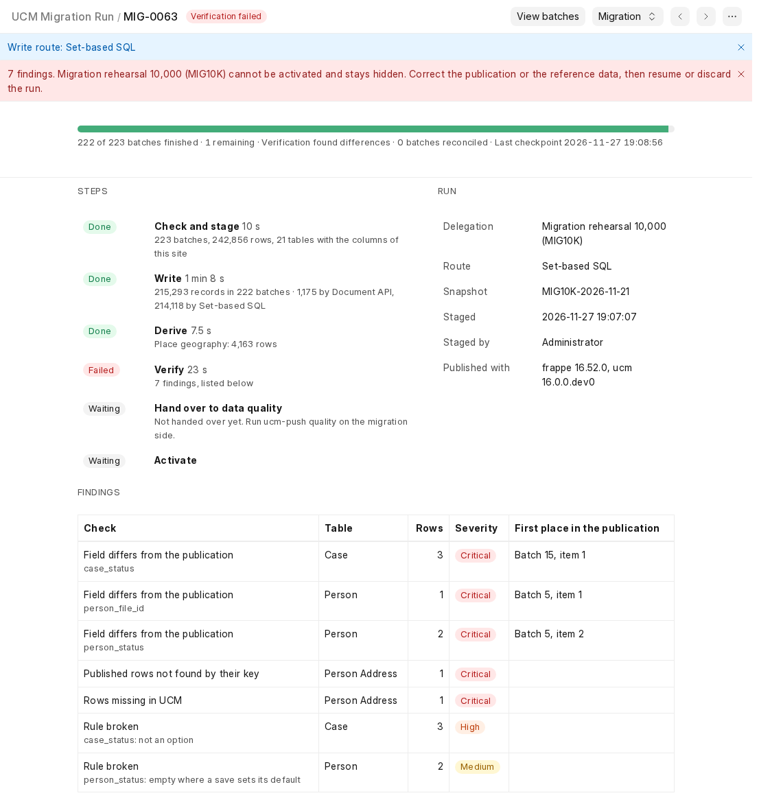

*Each finding names the check, the table, the number of rows, a severity and the first place in the publication. No record ID and no value is shown.*

| Severity | Findings |
|---|---|
| **Critical** | A row is missing or was not published; a field differs from the publication; a link points to nothing or out of the delegation. |
| **High** | A value outside its list, a missing required value, or another broken rule. |
| **Medium** | A field left empty where a save would have set its default. |

1. Give the batch and item of a finding to the publishing operator. On the publishing host, `ucm-push locate-item DEMO01-2026-11-27 --sequence BATCH --item ITEM` names the record.
2. If the site's reference data was at fault, correct it and choose **Migration → Resume from last receipt**: the delegation is derived and verified again.
3. If the publication was at fault, choose **Migration → Discard run** and ask for a new publication under a new snapshot name.

## Hand the metrics to data quality

*For the publishing operator, once a run has a verification report.*

The run's metrics are the target's part of the reconciliation: the rows published and stored per table, the fields compared, the rules checked, the errors by severity and the time of each step. They hold counts and rule names, never a record's key or value.

```sh
ucm-push quality DEMO01-2026-11-27
```

```text
53 metrics of run f1f73460c949… stored in file metrics.csv, table ucm_target_metric: none failing. The run has recorded the hand-over.
```

- The rows are written to `metrics.csv` in the snapshot's folder.
- Where the settings name a data quality database (`quality_config`), the same rows go into its table `ucm_target_metric`; `quality_table` in the settings names another.
- A run's rows replace the rows the same run left before, so the command can be repeated.

The run then shows the hand-over as done, with the account, the destination and the time.

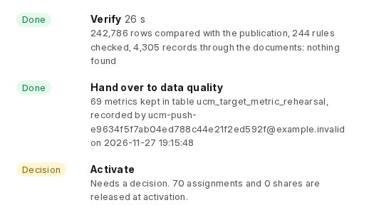

*The step says who stored the metrics, where and when. This picture is from a rehearsal: the table and the account are the rehearsal's own.*

> **Hand over again after activation.** Activation releases the assignments and shares, and the metrics then count them. The form shows the hand-over as due again until the command is repeated.

## Go live, or discard

*For the migration team, with the authority to open a delegation.*

### Activate the delegation

1. Open the verified run and read its steps and records once more.
2. Click **Activate delegation** and confirm. The activation is recorded with your name and the time. Once the delegation is open, the site removes its copy of the sealed file.
3. Stay on the form. A worker releases the assignments and shares and opens the context, in one step: either all of it happens or none. The form shows the open delegation when it is done.

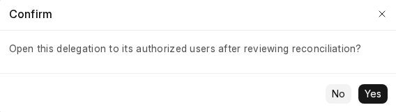

*The form asks once. Answer Yes only after the review.*

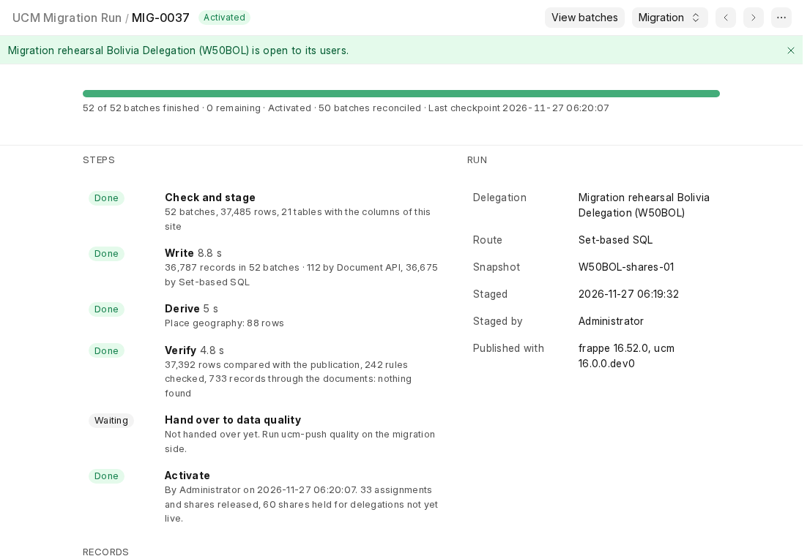

*An activated delegation: who opened it and when, the assignments and shares released, and the shares held for delegations that are not live yet.*

A share to a delegation that is not live yet is kept as a receipt under **UCM Migration Held Share**. It is released when that delegation is activated, after UCM has checked consent and eligibility again.

> **An activated delegation cannot be discarded.** From this moment its users work in it.

### Discard the run

Choose **Migration → Discard run** and confirm. The delegation's rows are removed in portions and the sealed file is deleted. The run and its receipts stay as a record, as **Discarded**. A new attempt needs a new publication under a new snapshot name.

## When something goes wrong

Nothing is ever half written: every batch that has a receipt is stored whole, and the rows of a batch that was being written when something stopped are gone. A load always resumes after its last receipt.

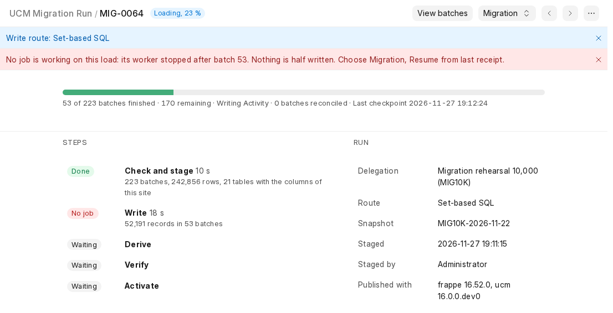

*The worker's job stopped. The form says so, with the batch reached, and names the action that resumes the load.*

| What you see | What to do |
|---|---|
| **No job is working on this load (or discard)** | The job's process was killed or its worker went down. Choose **Migration → Resume from last receipt** (or **Resume cleanup**). The list keeps showing Loading: open the run to see the notice. |
| Paused, with `apply after committed batch N: OperationalError` | The job lost its database connection. Have the database checked, then **Resume from last receipt**. |
| **Paused, with *… the delegation refers to is not on this site*, or *… differ from the publication*** | The site lacks something the delegation depends on. See [What the site must hold](#what-the-site-must-hold-before-a-load). |
| **Paused or not activated, with *Published … fields differ on target* and the names of fields** | UCM on this site stores those fields otherwise than the publication holds them. Have the site administrator check that the site runs the UCM release the publication was made for. The finding names the fields, never what they hold. |
| **Paused for live load** | The site's users were being slowed, by the limits set for this site. Resume when the site is quiet. |
| **Paused, with a batch and an item in the finding** | One record was refused. Give the batch and item to the publishing operator, who names the record with `ucm-push locate-item`. Correct the cause and resume, or discard. |
| **Verification failed** | See [Review what arrived](#review-what-arrived). |
| **Refused** | See [Approve the hand-off](#approve-the-hand-off). |
| Waiting for the file, with **Staging failed** in the banner | The file arrived and could not be staged, for the reason given. Have it corrected, then choose **Migration → Stage now**. |
| **The form offers no action, or Approve a hand-off is missing** | Your account lacks the Migration Admin role. Without it a run can be read and nothing else. A System Manager gives the role. |
| **The check code is refused** | Ask the publishing operator to read it again: `ucm-push propose` on the same snapshot repeats it. If it still differs, the proposal is not theirs: decline it. |
| `ucm-push propose` answers HTTP 403 | The account lacks the Migration Publisher role, or another account proposed this snapshot. A System Manager gives the role. |
| **The approval is refused: *The site's disk has … free, and this file needs …*** | The site holds the file once, in its private folder, and that folder's disk is too full for it. Have the site administrator free the space named, then approve again. |
| `ucm-push send` answers that the site's disk is full | The disk filled up after the approval. Nothing is lost: have the space freed, then send again, and the transfer goes on where it stopped. |
| **The transfer stopped** | Run `ucm-push send` again: it continues where it stopped. `ucm-push sent` shows how far it got. |
| **Stage now** answers that the file has not arrived completely | The publishing operator sends again. The file is staged by itself when it is whole. |
| `seal` answers that the delegation was not sealed | The reason is in the answer and in the snapshot's folder. Have the source corrected, and seal again. |
| `seal` answers that files are attached to persons *beside the person's picture*, or that a picture *is not held as one private file* | A publication carries a person's picture and no other attachment. The answer gives the number of files and persons, and the first person's identifier; `inventory.json` in the snapshot's folder holds the same. Have the other files detached or removed in the publishing database, and each picture held as one private file, then seal again. |
| **Configure write routes is missing** | The route can be chosen on a staged run only, before its first load. |
| `ucm-push` answers HTTP 403 | The account did not send this run, or the run does not exist on that site. Check the run's identifier, the site and the token. |

## Reference

### States in the list

| State | Meaning | Waits for |
|---|---|---|
| **Proposed, to approve** | The publishing operator proposed a hand-off. Nothing is accepted for it. | The migration team |
| **Waiting for the file** | The hand-off is approved. The file is on its way. | The publishing operator |
| **Staged** | The file is checked. Nothing is written. | The migration team |
| **Loading, N %** | A worker is writing or verifying. | The worker |
| **Paused** | Stopped between two batches, by a person or for a reason in the finding. | The migration team |
| **Verification failed** | Loaded, with findings. Hidden. | The migration team |
| **Verified, waiting for decision** | Loaded, nothing found. Hidden. | The go-live decision |
| **Activated** | The delegation is open to its users. | Nothing |
| **Discarding, Discarded** | The rows are being removed, or are gone. The receipts stay. | Nothing |
| **Refused** | The file did not fit the site. Nothing was written; the file that arrived is kept until it is staged again or removed. | The migration team |

### Commands of the publishing operator

Each takes the snapshot's name, or nothing from inside its folder.

| Command | Use |
|---|---|
| `ucm-push seal CODE` | Seal a delegation into a new folder, with its hand-off. |
| `ucm-push propose` | Propose the hand-off to the site, and get its check code. |
| `ucm-push sent`, `send` | How far a transfer got; send the file, or go on sending it. |
| `ucm-push status` | Where the run stands on the site. |
| `ucm-push report` | The run's verification report, as JSON. |
| `ucm-push quality` | Collect the run's metrics for the data quality database. |
| `ucm-push locate-item` | Name the record at a batch and item of the sealed file. |

The detailed commands behind these (`prepare`, `check-publication`, `send-publication` and others) take every value as an option. They are described in the repository, in `docs/detailed-commands.md`, for scripts.

### Roles

| Role | For | May |
|---|---|---|
| **Migration Admin** | The migration team | Approve or decline hand-offs, load, pause, activate and discard. Every action on a run needs this role. |
| **Migration Publisher** | The publishing accounts | Propose the hand-offs of their own sealed files. Nothing else: sending still needs an approval. |
| **System Manager** | The site's administrators | Read the runs, and give the two roles. |

### Without a browser

The approval and the staging can also be given from the site's bench, for scripts: `bench --site SITE ucm-migration approve HANDOFF --publisher ACCOUNT` and `ucm-migration stage HANDOFF`. The same page of the repository, `docs/detailed-commands.md`, describes them.

### Settings of the site

Set by the site administrator with `bench --site <site> set-config`. A running site reads a changed setting within a minute.

| Setting | Effect |
|---|---|
| `ucm_migration_route` | The route a newly staged run starts with. Without it, the Document API. |
| `ucm_migration_sample_every` | One record in so many goes through UCM's own check during the verification. 50 by default. |
| `ucm_migration_live_p95_ms`, `ucm_migration_max_lock_waits` | The limits beyond which a load pauses for the site's users. |
| `ucm_migration_quality_url` | A link with `{run}` in it: the form then offers **Open in data quality dashboard**. |
